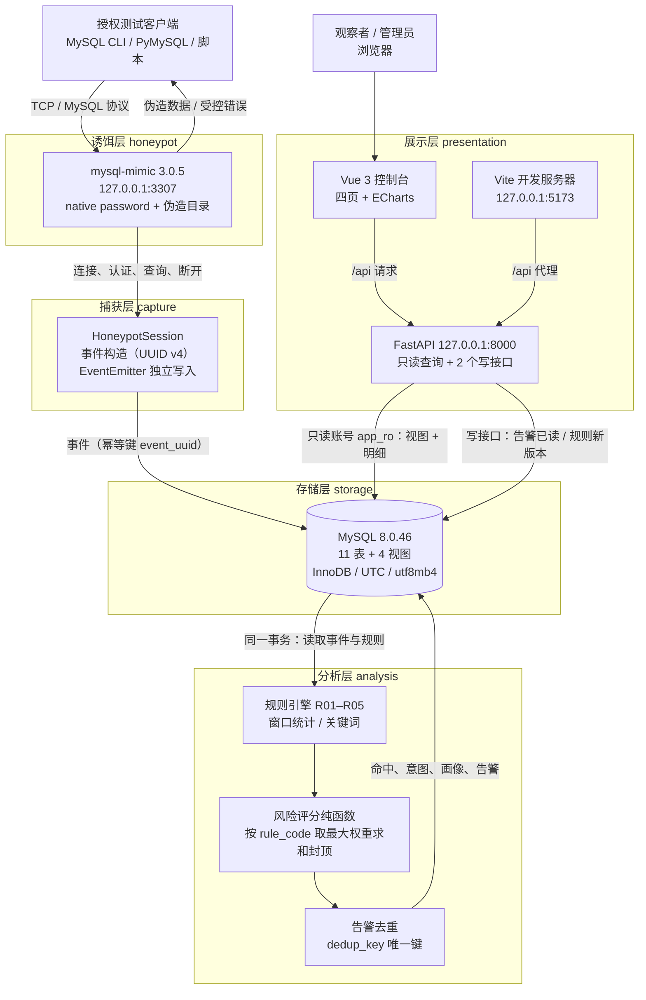
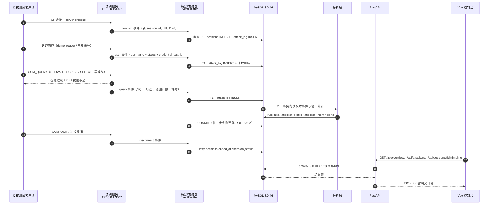
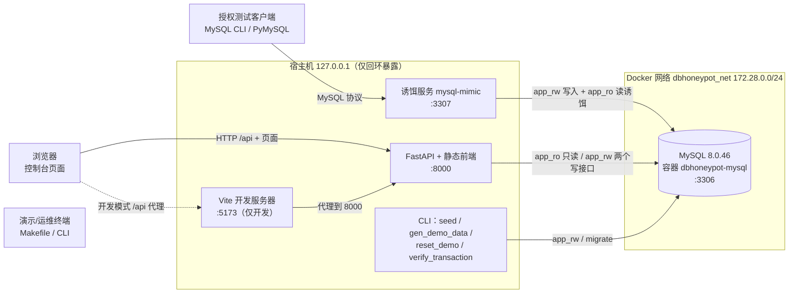

# 系统架构说明（architecture.md）

| 项目 | 内容 |
| --- | --- |
| 文档用途 | 说明数据库蜜罐与攻击行为分析系统的分层架构、数据流、模块职责、部署拓扑与安全边界 |
| 目标读者 | 课程小组成员、答辩演示者、代码评审者、在另一台实验机上复现项目的同学 |
| 编写基线 | 2026-11-19 仓库实际代码与运行环境（MySQL 8.0.46、隔离网段 172.28.0.0/24） |
| 与其他文档的关系 | 本文回答“系统由哪些层组成、数据如何流动、部署在哪里”；数据库对象细节见 [database-design.md](database-design.md)，验证步骤见 [test-plan.md](test-plan.md)，现场操作见 [demo-script.md](demo-script.md)，索引证据见 [explain-indexes.md](explain-indexes.md) |

> **口径说明**：本文只描述仓库中已经存在的实现。标注“待验证/未执行”的条目表示截至本文编写时
> 尚未完成实测，不能作为答辩时的既成事实。数据库当前实例的统计快照会随演示流量变化，
> 文中数字均注明采集时点。

---

## 1. 一句话架构

系统由一个**模拟 MySQL 协议的诱饵服务**接收授权测试流量，把连接、认证、查询与断开转换为标准事件；
事件在**单个数据库事务**中写入 MySQL 8 的 11 张业务表，并由确定性规则 R01–R05 在同一事务内生成
规则命中、攻击意图、攻击者画像与告警；Vue 3 控制台通过 FastAPI 只读接口查询 4 个核心分析视图，
形成“诱饵 → 捕获 → 存储 → 分析 → 展示”的五层闭环。

系统不是生产级安全平台：它只处理课程授权的隔离流量，规则阈值属于演示口径，协议只实现
MySQL 的最小子集。

---

## 2. 五层架构

### 2.1 分层职责

| 层次 | 主要职责 | 输入 | 输出 | 代码落点 |
| --- | --- | --- | --- | --- |
| 诱饵层 | 模拟 MySQL 握手、`mysql_native_password` 认证、`COM_QUERY` 路由；返回伪造库表或受控错误 | TCP 连接、认证响应、SQL 文本 | 伪造结果、`1045/1142/1148/1295` 等受控错误 | `backend/app/honeypot/` |
| 捕获层 | 把协议交互转换为标准事件（`event_uuid`、`session_id`、类型、时间、状态等），并异步写入存储层 | 协议处理过程 | `CapturedEvent` 标准事件 | `backend/app/honeypot/emitter.py`、`backend/app/services/event_builder.py` |
| 存储层 | 会话、事件、命中、意图、规则、画像、告警、诱饵与审计的持久化；事务、外键、唯一键、CHECK | 标准事件 | 可查询的关系数据 | `backend/app/services/ingest.py`、`session_manager.py`、`backend/app/repositories/`、`backend/migrations/` |
| 分析层 | 读取启用规则，按时间窗口与关键词判定意图；计算 0–100 风险分；更新画像/意图；生成去重告警 | 当前事件、规则配置、窗口统计 | `rule_hits`、`attacker_intent`、`attacker_profile`、`alerts` | `backend/app/services/analysis.py`、`risk.py`、`alerts.py`、`rules/` |
| 展示层 | 通过只读接口查询核心视图与明细，提供四页控制台；仅两个写操作：告警已读、规则版本变更 | HTTP 请求 | JSON、Vue 页面 | `backend/app/api/`、`frontend/src/` |

### 2.2 架构流程图



**关键点**：

1. 诱饵协议处理与数据库写入**解耦**：`EventEmitter` 写入失败只写运行日志，不改变对客户端的
   协议响应（`backend/app/honeypot/emitter.py`）。这保证“数据库故障不会让诱饵服务变成可被
   探测的异常服务”。
2. 分析不是独立消费者：规则判定与派生写入发生在**事件写入的同一个事务**内
   （`backend/app/services/ingest.py` 调用 `analysis.analyze_event`），保证“有告警必有事件、
   有命中必有证据”。
3. 展示层只读为主：FastAPI 的 `/api` 查询走 `honeypot_app_ro` 只读会话；仅
   `PATCH /api/alerts/{id}` 与 `PATCH /api/rules/{code}` 使用 `honeypot_app_rw`。

---

## 3. 数据流

### 3.1 端到端时序



### 3.2 事件到分析的关键字段

| 阶段 | 关键字段/约束 | 说明 |
| --- | --- | --- |
| 事件生成 | `event_uuid`（UUID v4，唯一）、`session_id`、`event_time`（UTC，秒级） | `event_uuid` 在事件构造时一次生成，重试复用同一值 |
| 事件入库 | `attack_log.event_uuid` 唯一键 `uk_attack_log_event_uuid` | 重复提交返回已有 `event_id`，不重复计数（幂等） |
| 会话维护 | `sessions.request_count` 原子自增；`connect` 建会话，`disconnect` 结束会话 | 同一会话事件共享 `session_id` |
| 规则判定 | `detection_rules WHERE enabled=1`；窗口走 `idx_log_source_time` / `idx_log_session_time` | 阈值来自数据库 `parameters_json`，不硬编码 |
| 命中快照 | `rule_hits.rule_code/risk_weight/rule_version/intent_type` | 规则改版后历史证据按旧快照解释 |
| 画像/意图 | `attacker_profile` 按 `source_ip` 唯一；`attacker_intent` 按 `(attacker_id,intent_type)` 唯一 | 会话与画像之间是逻辑聚合，不建外键 |
| 告警 | `alerts.dedup_key = <rule_code>:<source_ip>:<UTC 日期>` 唯一 | 首次插入，重复触发累加 `occurrence_count` |
| 展示 | 4 个视图 + 明细表；页面数字必须与视图查询一致 | 视图实时聚合，不做物化 |

### 3.3 风险分与告警口径（摘要）

- 计分单元是 `rule_code`：同一规则在同一统计范围内重复命中只计一次，取 `MAX(risk_weight)`。
- 三档分数一律 `LEAST(100, Σ 各规则最大权重)`：会话分、意图分、画像分口径不同但公式同源。
- 等级映射：0–29 `low`、30–59 `medium`、60–79 `high`、80–100 `critical`。
- 只有 `bruteforce` / `data_dump` / `destructive` 三类命中生成告警，等级固定为
  R02=`medium`、R04=`high`、R05=`critical`。
- 当前画像页存储值与视图重算值并列展示（`stored_risk_score` 与 `calculated_risk_score`），
  便于现场对账。

完整公式、边界场景与手算样例见 [database-design.md](database-design.md) 第 6 章与
`specs/001-database-honeypot/data-model.md` 第 9 章。

---

## 4. 模块职责与目录映射

### 4.1 仓库目录

| 目录 | 职责 | 关键文件 |
| --- | --- | --- |
| `backend/app/honeypot/` | MySQL 协议模拟、认证、伪造目录、事件发射 | `server.py`、`session.py`、`auth.py`、`fake_catalog.py`、`emitter.py` |
| `backend/app/services/` | 事件入库、会话管理、规则分析、风险评分、告警、重置、AI 辅助 | `ingest.py`、`session_manager.py`、`analysis.py`、`risk.py`、`alerts.py`、`reset.py` |
| `backend/app/services/rules/` | R01–R05 规则判定与公共契约 | `base.py`、`r01_scanning.py` … `r05_destructive.py` |
| `backend/app/repositories/` | 只读查询与写仓储（复用视图、统一分页/排序） | `overview_repo.py`、`attacker_repo.py`、`session_repo.py`、`alert_repo.py`、`rule_repo.py`、`audit_repo.py` |
| `backend/app/api/` | FastAPI 路由、依赖、统一错误 | `routes/overview.py`、`attackers.py`、`sessions.py`、`alerts.py`、`rules.py`、`ai.py` |
| `backend/app/models/` | SQLAlchemy 表模型（与迁移 DDL 对齐） | `sessions.py`、`attack_log.py`、`alerts.py` 等 |
| `backend/app/schemas/` | Pydantic 请求/响应模型与事件枚举 | `api.py`、`events.py`、`common.py` |
| `backend/app/db/` | 读写/只读/迁移三类异步引擎与会话 | `session.py` |
| `backend/app/cli/` | 种子、演示数据、重置、事务验证等脚本 | `seed.py`、`gen_demo_data.py`、`import_samples.py`、`simulate_traffic.py`、`explain_diff.py`、`reset_demo.py`、`verify_transaction.py` |
| `backend/migrations/` | Alembic 迁移：表、视图、索引、规则种子 | `versions/0001_initial_schema.py` … `0004_seed_rules.py` |
| `backend/tests/` | 单元/集成/接口测试目录 | 共 225 个用例（单元 142 / 集成 39 / 接口 42 / 冒烟 2）；需独占测试库串行运行 |
| `frontend/src/` | Vue 3 四页控制台、API 客户端、组件 | `views/`、`components/`、`api/client.ts`、`router/index.ts` |
| `db/init/` | MySQL 容器初始化：建库 + 四类账号库级授权 | `01-init-databases.sh` |
| `db/explain/` | EXPLAIN 前后对比 JSON/说明的约定目录 | 已生成 `explain_20261119T145423Z.json`，见 [explain-indexes.md](explain-indexes.md) |
| `scripts/` | 表级权限收紧等运维脚本 | `apply_table_grants.sh` |
| `compose.yaml` / `Makefile` | MySQL 编排与常用命令入口 | `make db-up/migrate/seed/api/honeypot/frontend-build/dev/test/reset/demo/explain` |

### 4.2 进程与代码映射

| 进程 | 启动命令 | 代码入口 | 默认监听 |
| --- | --- | --- | --- |
| MySQL | `docker compose up -d mysql` 或 `make db-up` | `compose.yaml` + `db/init/01-init-databases.sh` | `127.0.0.1:3306` |
| 诱饵服务 | `make honeypot` | `python -m app.honeypot.server` | `127.0.0.1:3307` |
| FastAPI | `make api` | `uvicorn app.main:app` | `127.0.0.1:8000` |
| 前端开发服务器 | `make dev` | `vite` | `127.0.0.1:5173` |
| 前端生产产物 | `make frontend-build` 后由 FastAPI 托管 | `frontend/dist` | 随 8000 端口提供 |

### 4.3 API 能力边界

已实现 11 个契约接口（与 `specs/001-database-honeypot/contracts/api.md` 一致）：

| 分类 | 接口 |
| --- | --- |
| 健康检查 | `GET /api/health` |
| 概览与趋势 | `GET /api/overview`、`GET /api/trend` |
| 攻击者 | `GET /api/attackers`、`GET /api/attackers/{ip}` |
| 会话 | `GET /api/sessions/{session_id}/timeline` |
| 告警 | `GET /api/alerts`、`PATCH /api/alerts/{alert_id}`（写） |
| 规则 | `GET /api/rules`、`PATCH /api/rules/{rule_code}`（写）、`GET /api/rules/effectiveness` |
| 可选 AI | `POST /api/ai/ask`（默认关闭；`AI_ENABLED=false` 时返回服务不可用，不影响核心闭环） |

**未提供 HTTP 写接口**：合成样本导入通过 CLI 完成，避免演示期间证据链可被任意 HTTP 请求篡改。

---

## 5. 部署视图

### 5.1 进程、网络与端口



### 5.2 端口清单

| 端口 | 服务 | 绑定地址 | 是否对外 | 说明 |
| --- | --- | --- | --- | --- |
| 3306 | MySQL 8.0.46（容器） | `127.0.0.1:3306`（compose 端口映射） | 否 | 持久化库，非诱饵；容器网络内为 `mysql:3306` |
| 3307 | 诱饵 MySQL 协议服务 | `127.0.0.1:3307` | 否 | 只允许回环监听；非回环地址拒绝启动 |
| 8000 | FastAPI + 前端静态文件 | `127.0.0.1:8000` | 否 | `/api/*` + 生产 `frontend/dist` |
| 5173 | Vite 开发服务器 | `127.0.0.1:5173` | 否 | 仅开发联调，`/api` 代理到 8000 |

### 5.3 Compose 编排

`compose.yaml` 当前只定义 **MySQL 一个服务**（不是 backend/web 容器）：

| 配置项 | 实际值 |
| --- | --- |
| 项目名 | `dbhoneypot` |
| 镜像 | `docker.1ms.run/library/mysql:8.0`（实测 `8.0.46`） |
| 容器名 | `dbhoneypot-mysql` |
| 字符集/排序规则 | `utf8mb4` / `utf8mb4_0900_ai_ci` |
| 时区 | `--default-time-zone=+00:00`，容器 `TZ=UTC` |
| 端口映射 | `127.0.0.1:3306:3306` |
| 数据卷 | `dbhoneypot_mysql_data:/var/lib/mysql` |
| 初始化挂载 | `./db/init:/docker-entrypoint-initdb.d:ro` |
| 健康检查 | `mysqladmin ping`，5 秒间隔、30 次重试 |
| 网络 | `dbhoneypot_net`，bridge，子网 `172.28.0.0/24` |

后端、诱饵与前端以**本机进程**方式运行（`Makefile`），因此“关闭顺序”应先停前端/后端/诱饵，
最后 `docker compose stop mysql`，避免应用持续写失败日志。

### 5.4 初始化与启动顺序

```bash
# 1) 环境与数据库
cp .env.example .env        # 首次；口令为 TEST-ONLY 占位，演示前按需替换
make setup                  # db-up + 依赖安装（首次）
make migrate                # alembic upgrade head：表、视图、索引、规则种子
make seed                   # 诱饵种子与规则（幂等）
# 2) 三个进程（分别开终端）
make honeypot               # 3307
make api                    # 8000
make frontend-build         # 或 make dev（5173）
# 3) 健康检查
curl -s http://127.0.0.1:8000/api/health
```

**实测快照（2026-11-19 14:43 UTC）**：

- `/api/health` 返回 `{"status":"ok","database":"ok","honeypot":"up","version":"1.0.0"}`；
- `ss -ltnp` 显示 3306、3307、8000 均监听在 `127.0.0.1`；
- 控制台 `GET /` 返回 `200 text/html`（`frontend/dist` 已构建并由 FastAPI 托管）。

> 注意：`make setup` 中的 `uv sync` 与 `make frontend-build` 依赖网络/本地缓存；
> 离线环境按 `specs/001-database-honeypot/quickstart.md` 的降级路径处理。

---

## 6. 安全边界

### 6.1 四条硬边界

| 边界 | 实现方式 | 证据/代码 |
| --- | --- | --- |
| **网络隔离** | MySQL 固定在 `172.28.0.0/24`；3306/3307/8000 只映射到 `127.0.0.1`；诱饵服务拒绝非回环监听 | `compose.yaml`、`backend/app/honeypot/server.py` 的 `_validate_host` |
| **只存不执行** | 采集到的 SQL 只作为字符串写入 `attack_log`，绝不拼进任何查询执行；写操作在诱饵层直接返回 1142，不产生真实数据变更 | `backend/app/services/ingest.py` 注释与实现、`contracts/events.md` 第 8 章 |
| **诱饵数据与观测数据分离** | 对外投影是 `honeypot_shop.users/orders/config` 与 `honeypot_archive.orders_2025`；物理表 `fake_*` 只读提供给诱饵层，不参与检测/画像计算 | `backend/app/honeypot/fake_catalog.py` |
| **AI 只读且可关闭** | AI 只复用 `app_ro` 只读会话，只执行白名单模板（不允许任意生成 SQL）；`AI_ENABLED=false` 时返回不可用，核心检测/画像/告警/页面不受影响 | `backend/app/services/ai_assistant.py`、`backend/app/api/routes/ai.py` |

### 6.2 四类数据库账号

| 账号 | 职责 | 设计权限（`data-model.md` 第 11 章） | 使用位置 |
| --- | --- | --- | --- |
| `honeypot_migrate` | DDL、迁移、视图、种子 | 建表/改表/删表/索引/视图/读写 | `alembic upgrade head` |
| `honeypot_app_rw` | 诱饵写入、分析派生、两个写接口 | 业务表 DML，无 DDL；`detection_rules` 不可删；`audit_log` 仅 S/I | `DATABASE_URL` |
| `honeypot_app_ro` | 控制台查询、答辩查询、AI 模板 | 仅 SELECT；`fake_users` 列级授权排除 `password_hash` | `READONLY_DATABASE_URL` |
| `honeypot_backup` | 备份 | SELECT + LOCK TABLES + SHOW VIEW 等，无写/DDL | 备份脚本（演示前） |

**实际状态（必须如实说明）**：截至本文编写时，`db/init/01-init-databases.sh` 已创建四类账号并
授予**库级**权限；表级最小权限收紧脚本 `scripts/apply_table_grants.sh` 已存在但**尚未在本实例
执行**。对当前实例执行 `SHOW GRANTS` 可见 `honeypot_app_rw` 仍为 `honeypot_dev.*` 的
`SELECT,INSERT,UPDATE,DELETE`，`honeypot_app_ro` 仍为库级 `SELECT`。因此：

- “四类账号职责分离、业务账号无 DDL”**已验证**；
- “`audit_log` 仅追加、`detection_rules` 不可删、`fake_users.password_hash` 列级隐藏”
  属于设计矩阵，**待执行 `scripts/apply_table_grants.sh` 后复验**（见 [test-plan.md](test-plan.md) 第 7 章）。

### 6.3 安全红线自检

- 诱饵数据全部为 `TEST-ONLY` 或 `example.test` / `example.invalid` / 保留号段，不含真实个人信息；
- `fake_users.password_hash` 由 CHECK 约束强制 `TEST-ONLY$` 前缀，不可用于认证；
- `fake_config.config_value` 由 CHECK 约束强制 `TEST-ONLY` 前缀，连接串只指向本机无效端口；
- 服务不执行客户端提交的任何 OS 命令，不支持文件上传、`LOAD DATA LOCAL INFILE`、`SELECT ... INTO OUTFILE`；
- `.env` 不提交仓库；文档与界面不展示完整口令，时间线只显示掩码后的用户名与 `credential_test_id`。

---

## 7. 当前实现边界与待验证项

| 事项 | 状态 | 说明 |
| --- | --- | --- |
| 11 张业务表 + 4 视图 + 复合索引 | 已验证 | 实例为 MySQL 8.0.46；`information_schema` 计数见 [database-design.md](database-design.md) |
| 四类账号库级分离 | 已验证 | 业务账号无 DDL；表级收紧待执行 |
| 诱饵服务 3307 + 健康检查 | 已验证 | 健康检查 `honeypot=up`；容器内 mysql 客户端连续 3 轮元数据查询均退出码 0（见 [test-plan.md](test-plan.md)） |
| 五条规则固定样本 | 已验证 | `import_samples --set demo_basic` 导入后 R01–R05 均有命中；固定 `session_id` 的事件数与样本预期一致（见 [test-plan.md](test-plan.md)） |
| 前端四页 | 部分验证 | `frontend/dist` 已构建并由 8000 托管；空态/筛选/告警已读交互待逐项复测 |
| `db/explain` JSON 记录 | 已生成 | `db/explain/explain_20261119T145423Z.json`；见 [explain-indexes.md](explain-indexes.md) |
| 自动化测试 | 部分验证 | 已收集 225 个用例（单元/集成/接口/冒烟）；并发运行会争用 `honeypot_test` 导致夹具失败，需独占环境复跑 |
| `import_samples` / `simulate_traffic` / `explain_diff` | 已实现 | `backend/app/cli/` 中三个脚本均存在，对应 Makefile 的 `demo` / `explain` 目标 |

---

## 8. 相关文档

- [数据库蜜罐系统项目总纲 1.1 扩充版](数据库蜜罐系统项目总纲_1.1_扩充版.md)：术语、验收口径与安全红线。
- [数据库设计说明书](database-design.md)：ER 图、11 表关系、4 视图、索引、事务、账号与迁移。
- [测试计划与验收矩阵](test-plan.md)：测试矩阵、SC-001–SC-015 映射、证据记录方式。
- [现场演示脚本](demo-script.md)：7 步演示、数据库专项演示、失败兜底与答辩口径。
- [索引与查询计划验证](explain-indexes.md)：两条高频查询的 EXPLAIN 前后对比与复现步骤。
- `specs/001-database-honeypot/spec.md`、`plan.md`、`data-model.md`、`contracts/api.md`、
  `contracts/events.md`、`contracts/honeypot-protocol.md`、`quickstart.md`：上游规格与契约。
