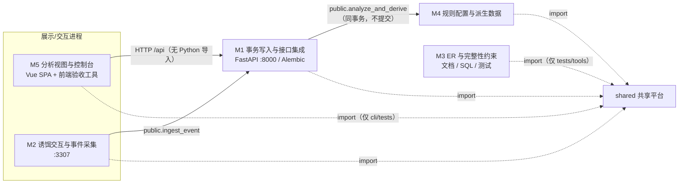
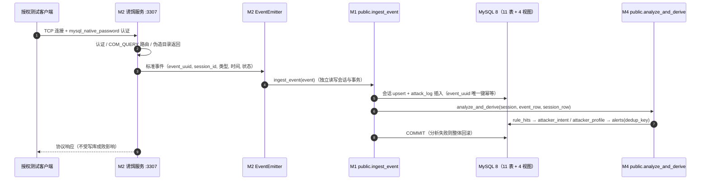
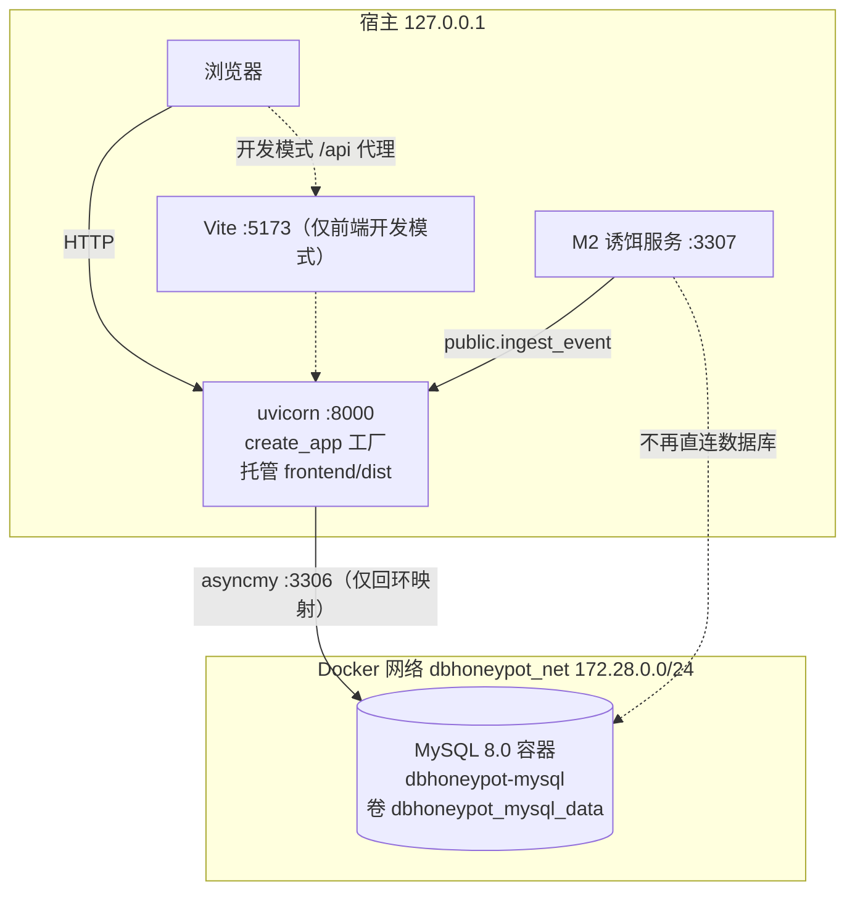

# 系统架构说明（architecture.md）

| 项目 | 内容 |
| --- | --- |
| 文档用途 | 说明模块化重构（`002-ui-console-modularization`）后的仓库结构、模块职责与依赖方向、运行时数据流、部署模型、控制台四页路由与验收入口 |
| 目标读者 | 课程小组成员、答辩演示者、代码评审者、在另一台实验机上复现项目的同学 |
| 编写基线 | 2026-11-25 仓库实际代码与运行环境（容器 `dbhoneypot-mysql` / `mysql:8.0`，实测 MySQL 8.0.46），模块化为 `shared/` + 五个 `modules/mN-.../` |
| 与其他文档的关系 | 本文回答“系统由哪些模块组成、谁依赖谁、数据如何流动、部署在哪里、怎么验收”；数据库对象细节见 [database-design.md](database-design.md)，部署与 13 步验收见 [deployment.md](deployment.md)，测试矩阵见 [test-plan.md](test-plan.md)，现场操作见 [demo-script.md](demo-script.md) |

> **口径说明**：本文只描述仓库中已经存在的实现，路径均可在仓库根直接 `ls`。
> 标注“待…”的条目表示对应交付尚未落地，不能作为答辩时的既成事实。
> 数据库统计快照随演示流量变化，本文数字注明采集时点。

---

## 1. 一句话架构

系统由一个**模拟 MySQL 协议的诱饵服务**（M2，`127.0.0.1:3307`）接收授权测试流量，把连接、
认证、查询与断开转换为标准事件；事件经 M1 的**唯一公开写入门面**在单个数据库事务中落库，
并在**同一事务内**调用 M4 门面完成 R01–R05 规则判定、攻击意图、攻击者画像与告警去重；
Vue 3 控制台（M5）由后端统一托管、经只读接口查询 4 个核心分析视图，形成
“诱饵 → 捕获 → 存储 → 分析 → 展示”的五段闭环。

代码组织为**单发行版多包**：根 `pyproject.toml`（hatchling）统一安装 `shared` 与
`m1_transaction_integration`、`m2_decoy_capture`、`m4_rules_derived`、`m5_views_console`
四个运行时包；M3 只有文档/SQL/测试，没有运行时包。模块之间**只经公开门面协作**，
依赖方向固定且无环，由 `make boundary` 静态检查阻断违规。

系统不是生产级安全平台：只处理课程授权的隔离流量，规则阈值属于演示口径，协议只实现
MySQL 的最小子集。

---

## 2. 仓库结构与模块职责

### 2.1 顶层目录树（截至 2026-11-25）

```text
db-honeypot/
├── README.md  pyproject.toml  alembic.ini  conftest.py  Makefile  compose.yaml  .env.example
├── shared/                          共享平台（包根即 shared/，无嵌套 shared/shared/）
│   ├── config.py  logging.py  errors.py
│   ├── db/        session / engine / errors（读写、只读、迁移三类会话）
│   ├── models/    SQLAlchemy 表模型（11 表，schema 契约）
│   ├── events/    StandardEvent / CapturedEvent 与 build_event、normalize_sql
│   ├── schemas/   Pydantic 公共响应模型（health、通用分页）
│   ├── utils/     masking / sql / risk（脱敏、归一化、风险等级）
│   ├── data/      只读查询与参数校验工具
│   ├── deploy/    check_structure.py、check_boundaries.py（兼容别名 boundary_check.py）、
│   │              verify_deploy.sh、demo.sh、offline_assets.py、tests/
│   └── tests/     共享层单元测试
├── modules/
│   ├── m1-transaction-integration/  事务写入与接口集成（唯一应用工厂、唯一迁移目录）
│   │   ├── m1_transaction_integration/{api,repositories,services,schemas,cli,public.py}
│   │   ├── migrations/versions/0001_initial_schema.py … 0004_seed_rules.py
│   │   ├── db/init/  db/grants/  tests/{api,integration}/  evidence/
│   ├── m2-decoy-capture/            诱饵交互与事件采集
│   │   ├── m2_decoy_capture/{server,session,auth,fake_catalog,emitter,public}.py
│   │   ├── m2_decoy_capture/{cli,samples}/  docs/explain-indexes.md  evidence/explain/  tests/unit/
│   ├── m3-er-constraints/           ER 与完整性约束（无运行时包）
│   │   ├── er/schema.mmd  constraints/{catalog.md,verify_constraints.sql}
│   │   ├── tools/introspect_constraints.py  tests/integration/  evidence/{constraints.json,schema.svg,schema.png}
│   ├── m4-rules-derived/            规则、派生数据、攻击者画像
│   │   ├── m4_rules_derived/{public,analysis,risk,alerts}.py  rules/  repositories/
│   │   └── tests/{unit,integration,api}/
│   └── m5-views-console/            分析视图、页面-数据库核对与控制台
│       ├── frontend/{src,verify,tailwind.config.js,dist/}   views/queries.sql
│       ├── m5_views_console/cli/verify_views.py  cli/verify_views.py（兼容入口）
│       └── tests/integration/test_views.py  evidence/{deploy,visual,sql-ui}/
├── tests/                           跨模块/根夹具（根 conftest.py 准备 honeypot_test）
├── docs/                            中文项目文档（本文件、部署、测试、演示、数据库设计、截图索引）
├── specs/                           Spec Kit 规格：001-database-honeypot、002-ui-console-modularization
└── ux/                              原型截图与 DESIGN 说明（视觉对照，不参与构建）
```

> 旧 `backend/`、根 `frontend/`、`scripts/`、根 `db/explain/` 已迁入 `shared/` 与 `modules/`；
> `make structure` 会阻止旧布局目录、嵌套 `shared/shared/`、旧导入前缀与写死本机路径回潮。

### 2.2 模块 → 职责 → 对外门面 → 依赖 → 关键目录

| 模块 | 职责 | 对外门面（跨模块唯一入口） | 允许依赖 | 关键目录 |
| --- | --- | --- | --- | --- |
| **M1** 事务写入与接口集成 | 事件写入与会话归集、Alembic 迁移、账号权限、FastAPI 应用与路由、演示重置、事务验证 CLI | `m1_transaction_integration.public.ingest_event` / `reset_demo`；应用工厂 `m1_transaction_integration.api.app:create_app`；CLI `cli.verify_transaction`、`cli.reset_demo` | `shared`、`m4_rules_derived.public`、自身 | `m1_transaction_integration/{api/routes,repositories,services,public.py}`、`migrations/versions/`、`db/init/`、`db/grants/`、`tests/{api,integration}/` |
| **M2** 诱饵交互与事件采集 | MySQL 协议握手/认证/`COM_QUERY` 路由、伪造目录、标准事件构造与发射、固定样本与授权模拟器、EXPLAIN 索引验证 | `m2_decoy_capture.public.serve` / `start`；CLI `python -m m2_decoy_capture.cli.{simulate_traffic,import_samples,gen_demo_data,explain_diff,seed_decoy}`；样本 `m2_decoy_capture.samples.catalog` | `shared`、`m1_transaction_integration.public`、自身 | `m2_decoy_capture/{server,session,auth,emitter,fake_catalog}.py`、`cli/`、`samples/`、`docs/explain-indexes.md`、`evidence/explain/` |
| **M3** ER 与完整性约束 | ER 图源文件、11 表的 PK/FK/UNIQUE/CHECK/索引规范与运行库对账、约束测试 | 数据与 SQL 文件：`er/schema.mmd`、`constraints/catalog.md`、`constraints/verify_constraints.sql`；工具 `tools/introspect_constraints.py`（**无 Python 运行时包**） | `shared`（仅 `tests/`、`tools/`） | `er/`、`constraints/`、`tools/`、`tests/integration/`、`evidence/` |
| **M4** 规则配置与派生数据 | R01–R05 判定、风险评分纯函数、意图/画像派生、告警去重与版本化、规则效果统计 | `m4_rules_derived.public.analyze_and_derive`（不提交事务）、`list_rules`、`list_rule_effectiveness`、`update_rule` | `shared`、自身 | `m4_rules_derived/{public,analysis,risk,alerts}.py`、`rules/`、`repositories/`、`tests/` |
| **M5** 分析视图与控制台 | 四个核心视图的查询口径与核对、页面-数据库抽样、Vue 3 四页控制台与前端验收工具链（Playwright/令牌审计/基线截图） | `views/queries.sql`（口径数据文件）；`python -m m5_views_console.cli.verify_views`（`--check-pages`）；前端产物 `frontend/dist`（由 M1 托管） | `shared`（仅 `cli/`、`tests/`）；运行期通过 **HTTP `/api`** 使用 M1，不产生 Python 导入 | `frontend/src`、`frontend/verify/`、`frontend/tailwind.config.js`、`views/`、`m5_views_console/cli/`、`evidence/{deploy,visual,sql-ui}/` |
| **shared** 共享平台 | 配置、日志、数据库会话、ORM 模型、标准事件契约、脱敏/归一化/风险工具、只读查询工具、构建/部署/边界/结构检查脚本 | `shared.config`、`shared.db`、`shared.models`、`shared.events`、`shared.schemas`、`shared.utils`、`shared.data`、`shared.deploy` | **无业务依赖**：不得导入任何 `m1_`…`m5_` 包 | `config.py`、`db/`、`models/`、`events/`、`schemas/`、`utils/`、`data/`、`deploy/`、`tests/` |

**所有权要点**（与 `specs/002-ui-console-modularization/contracts/module-boundaries.md` §2 一致）：

1. 唯一应用工厂在 M1：`uvicorn m1_transaction_integration.api.app:create_app --factory`；
2. 唯一 Alembic 迁移目录在 M1，根 `alembic.ini` 的 `script_location` 指向
   `modules/m1-transaction-integration/migrations`；
3. 唯一事件写入路径是 M1 的 `ingest_event`，M2 只调用它，不直接打开数据库会话；
4. 分析派生只经 M4 的 `analyze_and_derive`，由 M1 在其事务内调用并负责提交；
5. 前端产物只有 M5 的 `frontend/dist`，由 M1 按 `WEB_DIST_DIR` 挂载，不单独起 Web 服务器。

---

## 3. 依赖方向与禁止项

### 3.1 允许的依赖图



| 允许边 | 形式 | 说明 |
| --- | --- | --- |
| M5 → M1 | HTTP `/api/*` | 前端只走 HTTP；`frontend/src/api` 封装请求，不引用任何 Python 包 |
| M2 → M1 | `from m1_transaction_integration import public as transaction_api` | 只调用 `ingest_event`；发射失败只写运行日志，不影响协议响应 |
| M1 → M4 | `from m4_rules_derived import public as rules_derived` | 在同一事务内 `analyze_and_derive`，不复用 M4 内部仓储 |
| M1/M2/M4/M5 → shared | 各自的公开模块 | M5 仅 `cli/`、`tests/` 内导入；M3 仅 `tests/`、`tools/` 内导入 |
| 模块 → 自身 | 包内相对/绝对导入 | 同包内部允许 |

### 3.2 硬性禁止项

| 禁止 | 原因 | 检查方式 |
| --- | --- | --- |
| 跨模块导入内部子模块（`api` / `repositories` / `services` / `schemas` / `migrations` / `server` / `emitter`） | 内部实现可自由重构，跨模块直连会把重构变成全仓破坏 | `make boundary` 报 `cross_module_internal` |
| 反向依赖（`shared → mN_`、`M2 → M1.api`、`M4 → M1`、`M1 → M5`） | 破坏“共享平台无业务依赖”和分层方向 | `make boundary` 报 `reverse_dependency` |
| 旧导入前缀 `app.` / `backend.` / 嵌套 `shared.shared.` | 001 时代路径已删除，残留即失效导入 | `make boundary` 的 `legacy_imports`、`make structure` |
| 旧布局目录 `backend/`、根 `frontend/`、`scripts/`、嵌套 `shared/shared/` | 同一能力出现两个落点会导致“改一份不生效” | `make structure` 阻断 |
| 跨包循环导入 | Python 导入期不可预测地失败 | `make boundary` 的环检测 |
| 源码/配置写死本机绝对路径（如 `/Users/<name>/...`） | 换机器即失效 | `make structure` 扫描 |

### 3.3 自动化门禁

```bash
make structure   # python -m shared.deploy.check_structure：目录/包名/必需入口/旧布局/配置一致性
make boundary    # python -m shared.deploy.check_boundaries --json：允许矩阵 + 旧前缀 + 循环
```

两个目标退出码均为 `0` 通过 / `1` 违规 / `2` 扫描失败；边界检查同时断言“构造的违规样例必须失败”
（`shared/deploy/tests/test_check_boundaries.py`），避免检查器本身失效。

---

## 4. 运行时数据流

### 4.1 事件写入与分析（同事务）



**关键不变量**：

1. **有告警必有事件、有命中必有证据**：规则判定与派生写入和事件写入在同一事务，
   失败一起回滚（`m1_transaction_integration/services/ingest.py` → M4 门面）。
2. **幂等**：`attack_log.event_uuid` 唯一约束兜底；M2 发射器遇到 1213/1205 按
   50ms → 200ms → 800ms（±20% 抖动）退避重试，复用同一 `event_uuid`，不会重复计数或重复分析。
3. **降级不影响诱饵**：`EventEmitter` 写库异常只写运行日志，不改变对客户端的协议响应，
   避免“数据库故障把诱饵变成可探测的异常服务”。
4. **只存不执行**：采集到的 SQL 只作为字符串写入 `attack_log`，绝不拼进任何查询执行；
   诱饵层对写操作直接返回 `1142`，不产生真实数据变更。
5. **两套账号**：只读查询走 `honeypot_app_ro`（`READONLY_DATABASE_URL`），
   写入走 `honeypot_app_rw`（`DATABASE_URL`），DDL 只由 `honeypot_migrate` 执行。

### 4.2 风险分与告警口径（实现唯一事实）

| 项 | 口径 | 实现 |
| --- | --- | --- |
| 计分单元 | `rule_code`；同一规则同一范围重复命中只计一次，取命中快照最大权重 | `m4_rules_derived/risk.py` |
| 汇总 | `LEAST(100, Σ 各规则最大权重)`，三档（会话/画像/页面）同规则 | 同上 |
| 等级 | 0–29 `low` / 30–59 `medium` / 60–79 `high` / 80–100 `critical` | `shared/utils/risk.py` |
| 告警条件 | 仅 `intent_type ∈ {bruteforce, data_dump, destructive}`（R02/R04/R05）生成告警 | `m4_rules_derived/alerts.py` |
| 告警等级 | R02 `medium`、R04 `high`、R05 `critical`（不按会话分数区间推导） | 同上 |
| 去重 | `dedup_key = "<rule_code>:<source_ip>:<UTC 日期>"`，`uk_alerts_dedup_key` 唯一防线；重复触发只更新 `last_seen_at / occurrence_count / latest_hit_id / evidence_summary` | 同上 |

### 4.3 分析视图

四个视图由迁移 `0002_analysis_views.py` 创建，全部 `SQL SECURITY DEFINER`、只读、无 `ORDER BY`，
排序由查询侧决定；口径与可执行查询见 `modules/m5-views-console/views/queries.sql`：

| 视图 | 用途 | 主要页面 |
| --- | --- | --- |
| `v_session_risk_summary` | 会话维度汇总与重算风险分 | 攻击者详情 / 会话列表 |
| `v_attacker_profile_summary` | 来源画像、主要意图、风险等级 | 首页 KPI 与 TOP5、攻击者列表 |
| `v_daily_attack_trend` | 按 UTC 自然日的趋势/环比/累计/繁忙排名 | 首页趋势图 |
| `v_rule_effectiveness` | 规则命中覆盖与效果排名 | 首页环图、规则效果表 |

数据库对象（11 表、10 外键、12 唯一约束、38 CHECK、2 生成列、4 视图、5 条规则种子）
的实测清单见 `modules/m3-er-constraints/constraints/catalog.md` 与
`modules/m3-er-constraints/evidence/constraints.json`；设计说明见 [database-design.md](database-design.md)。

---

## 5. 部署模型

### 5.1 拓扑（容器 MySQL + 宿主后端，单地址）



- **单地址**：生产验证路径只有 `http://127.0.0.1:8000`；四页使用 hash 路由，
  刷新与深链不依赖服务器 rewrite。
- **诱饵独立进程**：默认只监听回环 `127.0.0.1:3307`，非回环监听会被拒绝
  （`m2_decoy_capture/server.py` 的 `_validate_host`）。
- **数据卷**：`dbhoneypot_mysql_data`；`make db-down` 保留卷，`docker compose down -v` 才清空。
- **初始化脚本**：`modules/m1-transaction-integration/db/init/` 挂载到
  `/docker-entrypoint-initdb.d`，首次启动建 `honeypot_dev` / `honeypot_test` /
  `honeypot_demo` 与四类最小权限账号。
- **前端不单独部署**：`make frontend-build` 生成 `modules/m5-views-console/frontend/dist`，
  M1 按 `WEB_DIST_DIR` 挂载；产物断言零外链（字体/图标/Logo 全部本地打包）。

完整说明（环境变量、卷生命周期、账号矩阵、排障）见 [deployment.md](deployment.md)。

### 5.2 端口

| 端口 | 进程 | 说明 |
| --- | --- | --- |
| 8000 | uvicorn（宿主） | 唯一控制台/API 地址；`/api/health` 健康检查 |
| 3306 | MySQL 容器 | 仅绑定 `127.0.0.1`；后端与迁移使用 |
| 3307 | M2 诱饵服务 | 模拟 MySQL，供授权客户端/模拟器连接 |
| 5173 | Vite（可选） | 仅前端独立开发模式；生产部署不使用 |

### 5.3 启动顺序

```bash
make db-up && make migrate && make seed     # 数据库就绪 + 固定种子数据
make frontend-build                          # 构建产物（后端托管）
make api                                     # 终端 A：uvicorn :8000
make honeypot                                # 终端 B：诱饵 :3307（演示流量用）
```

健康检查：`curl -s http://127.0.0.1:8000/api/health`；数据库不可用时返回 `503` 且
`status=degraded`，控制台顶部出现降级横幅并保留“最近一次成功数据”。

---

## 6. 控制台四页与路由

Vue 3 + Vite 8 + Tailwind 3.4.19，router 为 `createWebHashHistory`；四个路由固定在
`modules/m5-views-console/frontend/src/router/index.ts`，未知路径重定向到 `#/`。
设计令牌唯一来源是 `modules/m5-views-console/frontend/tailwind.config.js`
（令牌审计脚本直接读取该配置）。

| 页面 | 路由 | `<title>` | favicon | 主要区域（`data-region`） |
| --- | --- | --- | --- | --- |
| 首页概览 | `#/` | `首页概览 · DB Honeypot` | `favicon-overview.svg` | `OV-HEAD`、`OV-KPI`、`OV-TREND`、`OV-DONUT`、`OV-TOP5` |
| 攻击者列表 | `#/attackers` | `攻击者列表 · DB Honeypot` | `favicon-attackers.svg` | `AT-HEAD`、`AT-FILTER`、`AT-TABLE`、`AT-PAGER` |
| 攻击者详情与时间线 | `#/attackers/:ip` | `<ip> 攻击者详情 · DB Honeypot` | `favicon-detail.svg` | `AD-HEAD`、`AD-BANNER`、`AD-PROFILE`、`AD-CHAIN`、`AD-SESSIONS`、`AD-TIMELINE`、`AD-FOOTER` |
| 告警列表 | `#/alerts` | `告警列表 · DB Honeypot` | `favicon-alerts.svg` | `AL-HEAD`、`AL-STATS`、`AL-FILTER`、`AL-CARDS`、`AL-FOOTER` |

- 路由 query 承载筛选状态（如 `#/attackers?risk_level=high`、`#/alerts?is_read=false`），
  刷新可复现同一视图。
- 唯一写操作是告警已读（单条 `PATCH /api/alerts/{id}`；批量已读逐条调用，失败条目不静默丢弃）。
- 未支持的控件（导出 CSV、导出取证报告、同步证据链、DMZ 隔离）置灰并给出
  “演示未开放：…”说明，不产生假反馈。
- 区域契约与禁用策略的权威文本见
  `specs/002-ui-console-modularization/contracts/ui-contracts.md`。

后端接口面（FastAPI，全部以 `/api` 为前缀）：

| 方法 | 路径 | 用途 |
| --- | --- | --- |
| GET | `/api/health` | 数据库/诱饵状态与版本；DB 不可用返回 503 |
| GET | `/api/overview`、`/api/trend` | 首页 KPI（可限 `range`）与每日趋势 |
| GET | `/api/attackers`、`/api/attackers/summary`、`/api/attackers/{ip}` | 攻击者列表/摘要/详情 |
| GET | `/api/sessions/{session_id}/timeline` | 会话时间线与证据 |
| GET | `/api/alerts`、`/api/alerts/summary` | 告警列表（筛选+分页）与统计 |
| PATCH | `/api/alerts/{alert_id}` | 告警已读（唯一前端写操作） |
| GET | `/api/rules`、`/api/rules/effectiveness`；PATCH `/api/rules/{rule_code}` | 规则配置、效果、版本化变更 |
| POST | `/api/ai/ask` | 可选 AI 辅助（`AI_ENABLED=false` 时不可用） |

---

## 7. 验收入口

| 命令 | 作用 | 产物/证据 |
| --- | --- | --- |
| `make help` | 列出全部目标与用途 | 终端输出 |
| `make structure` | 目录结构门禁 | 终端 PASS/FAIL；`--json` 可机器读 |
| `make boundary` | 模块边界门禁 | 终端/JSON；`violations == []` |
| `make test` | 全仓 pytest（根 `tests/` + 各模块 `tests/` + `shared/deploy/tests`） | 终端汇总；当前收集 300 个用例（默认 270 + `shared/deploy/tests` 30） |
| `make frontend-build` | 构建控制台产物 | `modules/m5-views-console/frontend/dist` |
| `make verify` | 13 步部署验收（真实构建产物 + 真实浏览器 + 降级） | `modules/m5-views-console/evidence/deploy/run-N/` |
| `make verify2` | 视觉验收（两视口四页截图 + 令牌审计 + 区域清单） | `modules/m5-views-console/evidence/visual/` |
| `make verify3` | 确定性验收（固定种子 3 轮重建 + 跨轮摘要比对） | 同上 `deploy/run-N/` 多轮 |
| `make capture` | 采集四页基线截图 | `modules/m5-views-console/evidence/visual/baseline/`（待 T063 首次采集） |
| `make token-audit` | 设计令牌审计（0 违规） | `modules/m5-views-console/evidence/deploy/` |
| `make evidence` | 从已有 `run-N/` 重建 `summary.md` | `evidence/deploy/summary.md` |

底层实现：13 步脚本 `shared/deploy/verify_deploy.sh`（支持 `--visual` / `--compare-seed` /
`--summary-only`），浏览器检查 `modules/m5-views-console/frontend/verify/run-check.mjs`，
令牌审计 `.../verify/token-audit.mjs`，基线截图 `.../verify/capture-baseline.mjs`。
判定方法与退出码见 `specs/002-ui-console-modularization/contracts/deployment-verify.md`。

---

## 8. 安全边界

| 边界 | 实现 |
| --- | --- |
| 网络隔离 | MySQL 固定在 `172.28.0.0/24`；3306/3307/8000 只映射或监听 `127.0.0.1` |
| 只存不执行 | SQL 只作为字符串入库；诱饵对写操作返回 `1142`，无真实数据变更 |
| 诱饵数据与观测数据分离 | 对外投影 `honeypot_shop.*` / `honeypot_archive.*` 是伪造目录；`fake_*` 表不参与检测/画像计算 |
| 账号最小权限 | `honeypot_migrate`（DDL）/ `honeypot_app_rw`（DML）/ `honeypot_app_ro`（SELECT）/ `honeypot_backup`（备份）；可用 `db/grants/apply_table_grants.sh` 收紧到表级 |
| 库隔离 | `honeypot_dev` / `honeypot_test` / `honeypot_demo`；根 `conftest.py` 只在 `honeypot_test` 建/清表，`make test` 不动开发数据 |
| 敏感信息 | 认证事件只记 `username` 与 `credential_test_id`，不存口令；`shared/utils/masking.py` 统一脱敏；`.env` 不入库 |
| AI 只读且可关闭 | 复用 `app_ro` 只读会话，只执行白名单模板；`AI_ENABLED=false` 时返回不可用，核心链路不受影响 |
| 离线 | 前端零外链（字体/图标本地打包），`offline_assets.py` 扫描 `dist` 断言无外部 `http(s)` 引用 |

---

## 9. 当前实现边界与待交付项

| 项 | 状态 | 说明 |
| --- | --- | --- |
| 五模块目录 + `shared` | 已实现 | `make structure`、`make boundary` 可运行；模块 README 与 `evidence/` 已建 |
| 前端四页深色控制台 | 已实现 | 四页 hash 路由、令牌配置、本地字体图标；验收状态以最新 `evidence/deploy/run-N/deploy-record.json` 为准 |
| 部署验收证据 | 部分完成 | `evidence/deploy/run-N/` 已产出步骤记录、浏览器 JSON、两视口截图与种子摘要；最近一轮在步骤 8（浏览器导航检查）中止。重跑 `make verify` 后以最新轮次 `deploy-record.json` 的 `result` 为准 |
| 四页基线截图（T063） | 待采集 | 目标产物 `modules/m5-views-console/evidence/visual/baseline/{page}-{viewport}.png`；当前 `evidence/visual/summary.md` 无验收记录 |
| `docs/screenshots/*.png` | 001 期旧版 | 浅色 Element Plus 版历史截图，非当前深色控制台；索引见 [screenshots/README.md](screenshots/README.md) |
| M2 `explain_diff` 输出目录 | 待调整 | CLI 仍写仓库根 `db/explain/`，归档证据在 `modules/m2-decoy-capture/evidence/explain/`；文档以归档 JSON 为准 |
| Python 版本 | 环境相关 | `requires-python >= 3.11`；本机验收使用 3.13 解释器（`/tmp/dbh-venv`），ruff `target-version = py314` |

---

## 10. 相关文档

- [数据库设计说明书](database-design.md)：ER 图、11 表关系、约束、4 视图、索引、事务、账号与迁移。
- [部署模型与部署验收](deployment.md)：拓扑、端口、数据卷、环境变量、13 步验收与排障。
- [测试计划与验收矩阵](test-plan.md)：分层测试、002 验收场景、证据记录方式。
- [现场演示脚本](demo-script.md)：四页演示、降级演示、批量已读与禁用控件口径。
- [截图索引](screenshots/README.md)：旧版截图与四页基线命名约定。
- 模块说明：`modules/m1-transaction-integration/README.md`、`m2-decoy-capture`、`m3-er-constraints`、
  `m4-rules-derived`、`m5-views-console`、`shared/README.md`。
- 上游规格：`specs/002-ui-console-modularization/{spec.md,plan.md,tasks.md,quickstart.md,data-model.md}`；
  契约：`contracts/{module-boundaries.md,ui-contracts.md,deployment-verify.md,api-extensions.md}`。
- 索引验证：`modules/m2-decoy-capture/docs/explain-indexes.md` 与
  `modules/m2-decoy-capture/evidence/explain/explain_20261119T145423Z.json`。
