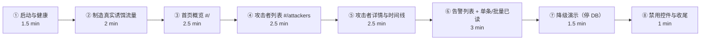

# 现场演示脚本（demo-script.md）

| 项目 | 内容 |
| --- | --- |
| 文档用途 | 给出可计时、可复现的现场演示脚本：启动 → 制造诱饵流量 → 四页逐页操作 → 降级 → 批量已读与禁用控件，并标注每步的预期可见结果与证据文件 |
| 目标读者 | 答辩演示者、同组替补、课程验收教师 |
| 建议时长 | 主流程 12–15 分钟（下表按 13 分钟编排）；答辩问答另计 3–5 分钟 |
| 前置依赖 | Docker（容器 `dbhoneypot-mysql`）、宿主 uvicorn `:8000`、诱饵 `:3307`、已构建的 `frontend/dist`；命令均在仓库根执行 |
| 与其他文档的关系 | 验收矩阵与命令见 [test-plan.md](test-plan.md)；部署与 13 步验收见 [deployment.md](deployment.md)；结构与依赖见 [architecture.md](architecture.md)；数据库对象见 [database-design.md](database-design.md)；区域契约见 `specs/002-ui-console-modularization/contracts/ui-contracts.md` |

> **演示纪律**：所有流量均为授权模拟；只连接 `127.0.0.1:3307`，不访问任何真实业务库；
> 不展示 `.env`、完整口令与真实个人信息；演示数据可随时用 `make reset-demo` 重置。
> 控制台只读为主，唯一写操作是“告警已读”。

---

## 0. 演示前检查（T-30 分钟，不计时）

```bash
cp -n .env.example .env          # 首次执行；口令为 TEST-ONLY 占位
make db-up                       # 容器 MySQL 就绪（首次自动建库 + 四类账号）
make migrate                     # alembic upgrade head（M1 迁移目录）
make seed                        # 固定种子：reset → gen(200/2400) → demo_basic 样本
make frontend-build              # 构建 dist（由后端托管，单地址）
make api                         # 终端 A：uvicorn :8000
make honeypot                    # 终端 B：诱饵 :3307

curl -s http://127.0.0.1:8000/api/health | python3 -m json.tool
open http://127.0.0.1:8000/#/    # macOS；Linux 用 xdg-open
```

**检查表**

| 项目 | 期望 |
| --- | --- |
| `docker compose ps` | `dbhoneypot-mysql` 为 `Up (healthy)` |
| `/api/health` | HTTP 200，`status=ok`，`database.status=ok` |
| 侧栏状态条 | 诱饵监听 `127.0.0.1:3307` 在线、`LIVE UTC+8` 时钟走动 |
| 首页 KPI | 四张卡有数字（不是 0 或 `—`），趋势/环图有图形 |
| 告警列表 | 有 `demo_basic` 产生的告警（R02/R04/R05），未读徽标在侧栏 04 显示 |

**失败兜底**：页面空白或 404 → 确认 `make frontend-build` 已生成
`modules/m5-views-console/frontend/dist/index.html`；告警统计卡显示 `—` 或接口报
`VALIDATION_ERROR` → 通常是部署产物滞后，执行 `make frontend-build` 后强制刷新；
数据库不可用 → `make db-up` 后等 healthcheck 变绿。

---

## 1. 总览与时间分配



---

## 2. 第 1 步：启动与健康（约 1.5 分钟）

**操作**

```bash
docker compose ps
curl -s http://127.0.0.1:8000/api/health
open http://127.0.0.1:8000/#/
```

**预期可见结果**

- `/api/health` 返回 200：`status=ok`、`database.status=ok`、`honeypot.listen=127.0.0.1:3307`。
- 页面为深色控制台（默认跟随系统外观）：固定左侧栏（品牌 + 诱饵状态 + 01–04 导航 +
  底部“内核视图/当前权限/规格版本”）、固定页头（`Honeypot-MySQL-01 (Isolated DMZ)`、
  `AI 辅助分析` 标签、`LIVE UTC+8` 时钟、主题切换按钮、“现场刷新数据”按钮）。
- 页头主题按钮为圆角矩形，默认显示“跟随系统”；点击循环“跟随系统 → 浅色 → 深色”，
  界面即时换肤且刷新后保持；把操作系统外观改为深/浅色时，`跟随系统` 模式下页面实时跟随。
- 首页标题右侧显示“演示库就绪: SEED RULES ACTIVE, LIVE TRAP ONLINE”。

**讲解点**：只有一个对外地址 `:8000`；前端是构建产物由后端托管，`dist` 里没有任何外部
CDN 引用（可出示 `offline-assets.json`）。双主题共用一套语义令牌（`--c-*`/`--chart-*`），
浅色配色对应 `ux/stitch_database_honeypot_analytics_console_light/`，不是简单反色。

**证据**：`modules/m5-views-console/evidence/deploy/run-1/offline-assets.json`（`external_refs: []`）、
`modules/m5-views-console/evidence/deploy/run-1/deploy-record.json`（第 1–7 步状态）、
`modules/m5-views-console/evidence/visual/theme-evidence.md`（双主题与实时跟随验收）。

**失败兜底**：`make db-up` 超时 → `docker compose logs mysql`；端口被占 → `make api API_PORT=8001`
并同步浏览器地址。

---

## 3. 第 2 步：制造一条真实诱饵流量（约 2 分钟）

**操作（授权模拟器，真实 MySQL 协议，来源 127.0.0.1）**

```bash
PYTHONPATH=.:modules/m1-transaction-integration:modules/m2-decoy-capture:\
modules/m4-rules-derived:modules/m5-views-console \
  .venv/bin/python -m m2_decoy_capture.cli.simulate_traffic \
  --target 127.0.0.1:3307 --rounds 3
```

**预期可见结果**

- 每轮一次独立会话；固定语句序列包含 `SHOW DATABASES`、`SHOW TABLES`、`DESCRIBE users`、
  两条 SELECT，以及 `UPDATE / DELETE / INSERT / DROP / TRUNCATE` 五个**预期被拒绝**的写操作。
- 终端打印每轮结果：读操作成功、写操作返回 `1142`（权限不足），客户端连接不中断。
- 控制台“现场刷新数据”，首页连接数/查询数增加；攻击者列表出现新来源，
  并在详情页看到踩点（R03）证据。

**讲解点**：写操作在诱饵层就被拒绝，数据库里没有任何真实变更；SQL 只作为字符串入库，
绝不拼进查询执行。诱饵只监听回环地址，非回环监听会被服务端直接拒绝。

**备选**：`make demo` 一键完成“导入 `demo_basic` 样本 → 检查/启动诱饵 → 运行模拟器 → 打印概览摘要”，
等价覆盖 R01–R05 与三类告警。

**证据**：`modules/m5-views-console/evidence/sql-ui/page-dom-capture.json`
（四页 DOM 文本 + 请求状态）、`modules/m5-views-console/evidence/sql-ui/checklist.md`（数据规模与核对结论）。

**失败兜底**：模拟器退出码 3 表示目标未被授权（非回环地址或不在
`HONEYPOT_ALLOWED_CLIENT_CIDRS`）；诱饵未启动时先 `make honeypot`。

---

## 4. 第 3 步：首页概览 `#/`（约 2.5 分钟）

**操作点**

1. 观察 `OV-KPI` 四张卡：连接数（`SRC: sessions`）、查询数（`SRC: attack_log`）、
   未处理告警（`SRC: alerts 未读`）、高风险攻击者（`SRC: v_attacker_profile`）。
2. 点击范围切换 `今日 24H` / `最近 7 天` / `全部历史`，观察 KPI 与趋势同步变化
   （URL query 变为 `?range=7d` 之类，刷新仍保持）。
3. `OV-TREND` 每日趋势面积图：悬停看每日事件/查询/告警，脚注写口径。
4. `OV-DONUT` 规则命中与意图分布：中心为总命中数，右侧图例 R01–R05 及占比。
5. `OV-TOP5` 高风险 TOP5：点“画像详情”下钻到攻击者详情。

**预期可见结果**

- KPI 数字与数据库视图一致（可现场用下方 SQL 对照）；卡片点击可跳转：
  攻击者相关卡 → `#/attackers`，未处理告警卡 → `#/alerts?is_read=false`。
- 趋势图与环图均由真实接口数据绘制，无数据时显示空态而不是假曲线。
- TOP5 按风险分从高到低，风险分条宽度与分数一致。

**现场核对（可选，终端 C）**

```bash
# 口令取仓库根 .env 的 MYSQL_ROOT_PASSWORD（TEST-ONLY 占位）
docker exec -it dbhoneypot-mysql mysql -uroot -p"$MYSQL_ROOT_PASSWORD" -e \
  "SELECT COUNT(*) AS sessions FROM honeypot_dev.sessions;
   SELECT COUNT(*) AS alerts FROM honeypot_dev.alerts;
   SELECT COUNT(*) AS high_risk FROM honeypot_dev.v_attacker_profile_summary
     WHERE risk_level IN ('high','critical');"
```

**证据**：`modules/m5-views-console/evidence/deploy/run-1/screenshots/overview-1440x900.png`
与 `overview-1920x1080.png`；数据库↔API↔页面逐项对照见
`modules/m5-views-console/evidence/sql-ui/checklist.md`；
视图口径与可执行查询见 `modules/m5-views-console/views/queries.sql`。

**失败兜底**：范围切换后数字不变 → 看 Network 里 `/api/overview?range=…` 是否 200；
401/422 → 确认 uvicorn 与 `dist` 版本一致（重建产物）。

---

## 5. 第 4 步：攻击者列表 `#/attackers`（约 2.5 分钟）

**操作点**

1. `AT-HEAD` 汇总卡：高危及严重攻击源数量、最近意图。
2. `AT-FILTER` 搜索框输入 `198.51.100`（来源均为 RFC 5737 文档网段），点“搜索”。
3. 风险档筛选：全部 / 严重 (≥80) / 高 (60–79) / 中 (30–59) / 低 (0–29)；
   意图下拉（5 类 + 全部）；排序基准（风险分/最近出现/首次出现/累计会话）。
4. 观察 URL query 变化（`?q=…&risk_level=high&sort=…`），刷新后筛选仍生效。
5. `AT-PAGER` 翻页，筛选条件保持；越界页码回退第 1 页。
6. 指一下置灰的“导出遥测 CSV”按钮：`演示未开放：导出功能不在本版范围`。

**预期可见结果**

- `AT-TABLE` 八列：来源 IP（IP + 网络归属标签）、首次出现、最近出现、主要意图、
  会话数、查询数、风险分（条 + 数值）、等级、操作；风险分条宽度 = 分数百分比。
- 搜索/筛选即时请求真实接口；无匹配时显示空态 + “清除筛选条件”。
- 点“画像详情”进入 `#/attackers/:ip`。

**证据**：`modules/m5-views-console/evidence/deploy/run-1/screenshots/attackers-1440x900.png`
与 `attackers-1920x1080.png`；接口与页面数值一致性见
`modules/m5-views-console/evidence/sql-ui/checklist.md`（攻击者列表组）。

**失败兜底**：列表一直加载 → `/api/attackers` 是否 200；`SRC` 标注缺失说明页面读的不是新产物。

---

## 6. 第 5 步：攻击者详情与时间线 `#/attackers/:ip`（约 2.5 分钟）

**操作点**

1. 从列表点入（或直接打开 `#/attackers/198.51.100.17`）。
2. `AD-HEAD`：返回链接、h1 为 IP、子网/网络归属徽标、四枚快捷指标
   （综合风险分、累计会话、执行查询、认证尝试含成功/失败）。
3. `AD-BANNER` 脱敏横幅：“演示数据已脱敏 · 不执行任何采集 SQL”。
4. `AD-PROFILE` 左卡六行键值（首次/最近出现、会话数、查询数、平均时长、高危操作次数）
   + 威胁等级盒 + 处置建议；下方两个禁用按钮。
5. `AD-TIMELINE` 时间线：按时间列出事件类型、状态、SQL 归一化片段与规则命中标签
   （R01–R05 的命中权重与证据摘要）。
6. 指一下禁用控件：“DMZ 隔离（联动）”与“导出取证报告 / 同步证据链”，
   `title` 分别为 `演示未开放：…`。

**预期可见结果**

- 四枚快捷指标与 `v_attacker_profile_summary` / 画像字段一致；
- 高风险来源（如风险分 85）威胁等级盒为 `critical`，会话/事件都能在时间线找到对应证据；
- 被拒绝的写操作在时间线里显示为失败状态与 `1142`，不是“成功篡改”。

**讲解点**：从“一条告警”能一路下钻到“哪个会话、哪条事件、哪条规则、权重多少”，
这就是“可解释”的落点；告警的 `latest_hit_id` 指向具体命中快照。

**证据**：`modules/m5-views-console/evidence/deploy/run-1/screenshots/attacker-detail-1440x900.png`
与 `attacker-detail-1920x1080.png`；画像与页面数值核对见
`modules/m5-views-console/evidence/sql-ui/verify-views.json`（`--check-pages` 部分）。

**失败兜底**：详情页 404（`ATTACKER_NOT_FOUND`）→ 该 IP 没有画像，先制造流量或导入样本；
时间线为空 → 刷新页面重取，或检查 `:session` query 是否指向已存在会话。

---

## 7. 第 6 步：告警列表 + 单条/批量已读 `#/alerts`（约 3 分钟）

**操作点**

1. `AL-HEAD` / `AL-STATS`：未读告警数、已读/总数、今日新增、今日高峰时段。
2. 标签页：全部告警 / 未读 / 已读；筛选项：等级、类型（如“批量拖库 (R04)”）、
   时间范围（今日 / 近 3 天 / 近 7 天）。
3. 单条处置：点某条告警“标记已读” → 顶部 toast 显示 `告警 #<id> 已标记已读`，
   卡片状态与统计卡同步变化。
4. 批量处置：勾选 2–3 条 → 按钮变为 `批量标记已读 (N)` → 点击。
5. 观察底部说明：“批量标记逐条提交（并发 2），失败条目不静默丢弃”。

**预期可见结果**

- 批量成功：toast `已标记 N 条告警为已读`，副文案“列表与统计卡已同步更新”；
  侧栏 04 未读徽标随未读数减少，为 0 时隐藏但仍保留编号 04。
- 部分失败：toast 类型为 `partial`，文案 `部分成功：X 条已读，Y 条失败`，并列出前 3 条失败原因；
  失败条目仍保持未读，可重试。
- 空态/无数据不显示假卡片。

**强制演示“部分/全部失败”（可选 30 秒）**：先勾选若干告警，再执行
`docker stop dbhoneypot-mysql`，点击批量已读 → 出现失败 toast；
`docker start dbhoneypot-mysql` 恢复后再点一次即可成功（顺带进入下一步降级话题）。

**证据**：`modules/m5-views-console/evidence/deploy/run-1/screenshots/alerts-1440x900.png`
与 `alerts-1920x1080.png`；告警统计的 SQL↔API 对照见
`modules/m5-views-console/evidence/sql-ui/checklist.md`（组 2）；
逐条 PATCH 与部分失败语义见 `specs/002-ui-console-modularization/contracts/ui-contracts.md` §6.4。

**失败兜底**：统计卡显示 `—` → 先 `make frontend-build` 再刷新；标记已读报错但数据已变 →
刷新页面确认（写操作是逐条 PATCH，幂等重试安全）。

---

## 8. 第 7 步：降级演示（停 DB，约 1.5 分钟）

**操作**

```bash
docker stop dbhoneypot-mysql
curl -i http://127.0.0.1:8000/api/health        # 期望 503 + status=degraded
curl -sI http://127.0.0.1:8000/ | head -1       # SPA 入口仍 200（静态资源不依赖库）
# 浏览器在控制台点“现场刷新数据”，观察降级横幅
docker start dbhoneypot-mysql
curl -s http://127.0.0.1:8000/api/health        # 恢复 200 + status=ok
```

**预期可见结果**

- `/api/health` 变为 HTTP 503，`status=degraded`，`database.status=down`。
- 控制台顶部出现红色横幅：**“数据库不可用或健康检查失败，以下为最近一次成功数据。”**
  右侧带“重试”按钮；页面保留最后一次成功数据，不白屏、不弹出未处理异常。
- 页面静态资源（SPA 入口、字体、图标）仍然 200，说明前端不依赖数据库即可加载。
- `docker start` 后点“重试”或“现场刷新数据”，横幅消失、KPI 恢复。

**讲解点**：降级是“只影响数据新鲜度、不吞掉页面”的设计；诱饵服务与之解耦，
数据库故障不会让诱饵变成可被探测的异常服务。

**证据**：`modules/m5-views-console/evidence/deploy/run-1/deploy-record.json` 第 11 步
（降级检查）与 `modules/m5-views-console/evidence/deploy/run-1/browser.json`
（四页 × 两视口的 console/请求/溢出记录）。

---

## 9. 第 8 步：禁用控件与收尾（约 1 分钟）

**逐项说明**（现场指认，不点击）

| 位置 | 控件 | 禁用文案 |
| --- | --- | --- |
| 攻击者列表 `AT-FILTER` | 导出遥测 CSV | `演示未开放：导出功能不在本版范围` |
| 攻击者详情 `AD-PROFILE` | DMZ 隔离（联动） | `演示未开放：系统仅分析，不执行主动反制` |
| 攻击者详情 `AD-FOOTER` | 导出取证报告 (JSON/CSV) | `演示未开放：导出功能不在本版范围` |
| 攻击者详情 `AD-FOOTER` | 同步证据链至防御规则库 | `演示未开放：需要规则下发通道` |
| 侧栏 03（未从列表进入时） | 攻击者详情与时间线 | `请先从攻击者列表进入`（`aria-disabled="true"`） |

**讲解点**：没有数据或通道支撑的控件一律置灰并写明原因，不做“点了没反应”的假交互；
所有可点的卡片/行/导航都指向真实路由。

**收尾**：`make evidence` 用已有证据重建 `evidence/deploy/summary.md`；
`make verify` 可整轮重跑（13 步），轮次目录为 `evidence/deploy/run-N/`。

---

## 10. 演示后记录

| 字段 | 内容 |
| --- | --- |
| 日期/环境 | 2026-11-25，容器 MySQL 8.0.46（`mysql:8.0`），API `:8000`，诱饵 `:3307` |
| 使用样本 | `demo_basic`（S01–S07）或 `S03+S04`；模拟器轮数 |
| 关键会话/告警 | `session_id`、`event_id`、`alert_id`、`dedup_key`、风险分与等级 |
| 结果 | 四页与降级是否全部完成；失败步骤与兜底方式 |
| 截图/录屏 | 本轮 `evidence/deploy/run-N/screenshots/`；四页基线见 `evidence/visual/baseline/`（待 T063 采集） |
| 收尾 | 是否 `docker start dbhoneypot-mysql`、是否停掉 uvicorn 与诱饵进程 |

---

## 11. 相关文档

- [test-plan.md](test-plan.md)：测试矩阵、002 验收场景与证据记录方式。
- [deployment.md](deployment.md)：拓扑、环境变量、13 步验收与排障。
- [architecture.md](architecture.md)：模块结构、依赖方向、端口与安全边界。
- [database-design.md](database-design.md)：ER、约束、视图、事务与账号。
- [screenshots/README.md](screenshots/README.md)：旧版截图索引与四页基线命名约定。
- `modules/m2-decoy-capture/docs/explain-indexes.md`：两条高频查询的 `EXPLAIN` 对比
  （归档 JSON：`modules/m2-decoy-capture/evidence/explain/explain_20261119T145423Z.json`）。
- `modules/m3-er-constraints/constraints/catalog.md`：11 表 / 10 外键 / 12 唯一 / 38 CHECK 实测清单。
