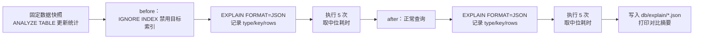

# 索引与查询计划验证记录（explain-indexes.md）

| 项目 | 内容 |
| --- | --- |
| 文档用途 | 记录两条高频查询在复合索引可用/不可用时的 `EXPLAIN` 计划与实测耗时，回答“索引是否被使用、收益是什么” |
| 目标读者 | 数据库设计评审者、答辩讲解人、负责 SC-013 的测试执行人 |
| 证据来源 | `db/explain/explain_20261119T145423Z.json`（由 `python -m app.cli.explain_diff` 生成） |
| 与其他文档的关系 | 设计依据见 `specs/001-database-honeypot/data-model.md` 第 7 章与 [database-design.md](database-design.md) 第 6 章；验收项见 [test-plan.md](test-plan.md) SC-013；现场演示见 [demo-script.md](demo-script.md) 第 3.5 节 |
| 结论摘要 | 会话时间线查询 `ALL → ref`（扫描行数 2174 → 16）；近期高等级告警 `ALL → ref`（扫描行数 9 → 3）；两条查询均命中目标复合索引，`filesort` 消除 |

> **数据规模说明**：本记录在演示数据规模（`attack_log` 2226 行、`sessions` 223 行、
> `alerts` 9 行）上采集，属于课程验证而非压力测试。`alerts` 行数很少，因此告警查询的
> 耗时差异很小；答辩时应强调 `type/key/rows/filesort` 的计划变化，而不是绝对毫秒数。

---

## 1. 证据文件

| 项 | 值 |
| --- | --- |
| 文件 | `db/explain/explain_20261119T145423Z.json`（约 13.5 KB） |
| 生成时间 | `2026-11-19T14:54:23Z` |
| 生成命令 | `cd backend && .venv/bin/python -m app.cli.explain_diff` |
| 数据库 | `honeypot_dev` @ `127.0.0.1:3306`，MySQL `8.0.46` |
| 数据快照 | `attack_log=2226`、`sessions=223`、`alerts=9`、`rule_hits=54`、`attacker_profile=15` |
| 计时口径 | 同一只读连接、同一份数据；预热后执行 5 次取中位数（`timing_runs=5`） |
| 对比方法 | **不执行任何 DDL**：before 查询用 `IGNORE INDEX` 显式禁用目标索引，after 正常执行 |

> 该文件是 `db/explain/` 目录中当前的**最新记录**；后续重新生成会按 UTC 时间戳新增文件，
> 不会覆盖旧文件。答辩时以最新文件为准，并同时说明数据规模。

---

## 2. 方法



**为什么不用“删索引再建索引”**：`DROP INDEX / ADD INDEX` 是 DDL，会改变实例状态并可能污染
统计信息；`IGNORE INDEX` 与 MySQL 8 的不可见索引（`ALTER INDEX ... INVISIBLE`）都能实现
“计划层面禁用索引”的等价对比。本脚本选择 `IGNORE INDEX`，对数据与结构零改动。

---

## 3. 两条目标查询

### 3.1 Q1：按会话时间线读取事件

```sql
-- after：索引可用
SELECT event_id, event_type, event_time, status
FROM attack_log
WHERE session_id = '5a060001-0000-4000-8000-000000000001'
ORDER BY event_time, event_id;

-- before：显式禁用目标索引（等价“索引不可用”）
SELECT event_id, event_type, event_time, status
FROM attack_log IGNORE INDEX (idx_log_session_time)
WHERE session_id = '5a060001-0000-4000-8000-000000000001'
ORDER BY event_time, event_id;
```

**目标索引**：`idx_log_session_time (session_id, event_time)`。
**目标查询来源**：`GET /api/sessions/{id}/timeline`、控制台会话时间线（FR-065/SC-003）。
**反例判断**：若出现 `type=ALL` 或 `Using filesort`，说明没有利用索引前缀排序。

### 3.2 Q2：筛选近期高等级告警

```sql
-- after：索引可用
SELECT alert_id, severity, created_at
FROM alerts
WHERE severity = 'critical'
ORDER BY created_at DESC
LIMIT 20;

-- before：显式禁用目标索引
SELECT alert_id, severity, created_at
FROM alerts IGNORE INDEX (idx_alert_level_time)
WHERE severity = 'critical'
ORDER BY created_at DESC
LIMIT 20;
```

**目标索引**：`idx_alert_level_time (severity, created_at)`。
**目标查询来源**：告警列表按等级/时间筛选（FR-034/FR-066），页面默认 `created_at DESC`。
**反例判断**：`type=ALL` + `Using filesort` 表示先全表过滤再排序；理想为等值列
`severity` + 时间列有序 + 反向扫描。

---

## 4. 计划与耗时对比

### 4.1 G1：Q1 会话时间线

| 指标 | before（`IGNORE INDEX`） | after（索引可用） | 变化 |
| --- | --- | --- | --- |
| `type` | `ALL` | `ref` | 全表扫描 → 索引查找 |
| `possible_keys` | `NULL` | `["idx_log_session_time"]` | 索引进入候选 |
| `key` | `NULL` | `idx_log_session_time` | 命中目标索引 |
| `key_len` | `NULL` | `36` | 使用 `session_id`（`CHAR(36) ascii`） |
| `ref` | `NULL` | `const` | 常量等值查找 |
| `rows`（估算扫描行数） | `2174` | `16` | 约 **136×** 下降 |
| `rows_produced` | `10` | `16` | 结果集量级一致（命中 16 条样本事件） |
| `filtered` | `0.46%` | `100.00%` | 过滤后全部命中 |
| `using_filesort` | `true` | `false` | 排序由索引顺序提供 |
| `query_cost` | `234.92` | `5.60` | 成本约 **42×** 下降 |
| 实测耗时中位数（5 次） | `2.749 ms` | `1.253 ms` | 约减少 54% |
| 实测范围 | 2.704–2.791 ms | 1.244–1.350 ms | — |

**结论**：计划由全表扫描 + 文件排序变为复合索引等值查找，且 `ORDER BY event_time`
利用索引第二列，`filesort` 消失；估算扫描行数从 2 174 降到 16，符合 Q1 的预期判定标准。

### 4.2 G2：Q2 近期高等级告警

| 指标 | before（`IGNORE INDEX`） | after（索引可用） | 变化 |
| --- | --- | --- | --- |
| `type` | `ALL` | `ref` | 全表扫描 → 索引查找 |
| `possible_keys` | `NULL` | `["idx_alert_level_time"]` | 索引进入候选 |
| `key` | `NULL` | `idx_alert_level_time` | 命中目标索引 |
| `key_len` | `NULL` | `34` | 使用 `severity`（`VARCHAR(8)`）+ 排序 |
| `rows`（估算扫描行数） | `9` | `3` | 下降（表仅 9 行） |
| `rows_produced` | `3` | `3` | 结果一致 |
| `filtered` | `33.33%` | `100.00%` | 过滤后全部命中 |
| `using_filesort` | `true` | `false` | 排序由索引提供 |
| `using_index` / `backward_index_scan` | `null` / `null` | `true` / `true` | 覆盖索引 + 反向扫描 |
| `query_cost` | `4.15` | `0.55` | 成本约 **7.5×** 下降 |
| 实测耗时中位数（5 次） | `1.054 ms` | `0.998 ms` | 约减少 5% |
| 实测范围 | 0.991–1.121 ms | 0.994–1.084 ms | — |

**结论**：计划从全表扫描 + 文件排序变为 `severity` 等值 + 索引反向扫描；虽然当前只有 9 行、
毫秒差很小，但 `type/key/rows/filesort` 的变化证明索引路径正确，数据量增大后差异会扩大。

### 4.3 汇总

| 组 | 查询 | 索引 | before | after | 扫描行数 | 中位耗时 |
| --- | --- | --- | --- | --- | --- | --- |
| G1 | Q1 会话时间线 | `idx_log_session_time` | `ALL / NULL / filesort` | `ref / idx_log_session_time / 无 filesort` | 2174 → 16 | 2.749 → 1.253 ms |
| G2 | Q2 近期高等级告警 | `idx_alert_level_time` | `ALL / NULL / filesort` | `ref / idx_alert_level_time / 反向扫描` | 9 → 3 | 1.054 → 0.998 ms |

---

## 5. JSON 记录字段说明

`explain_YYYYMMDDTHHMMSSZ.json` 的顶层结构：

| 字段 | 含义 |
| --- | --- |
| `generated_at` | 生成时间（UTC） |
| `database.host/port/schema` | 采集实例与库 |
| `dataset.mysql_version` | MySQL 版本（本次 8.0.46） |
| `dataset.tables` | 数据快照：`attack_log/sessions/alerts/rule_hits/attacker_profile` 行数 |
| `dataset.session_id_used` | Q1 使用的真实会话编号 |
| `method` | 对比方法（`IGNORE INDEX`，无 DDL） |
| `timing_runs` | 计时次数（本次 5） |
| `indexes` | 相关表的索引清单（名称、唯一性、可见性、列顺序） |
| `groups[]` | 两组对比：`group/query_id/name/table/expected_index` |
| `groups[].sql.before/after` | 两条待对比 SQL |
| `groups[].query_params` | 查询参数（如 `session_id`） |
| `groups[].explain.before/after` | `EXPLAIN FORMAT=JSON` 原始结果 |
| `groups[].plan_fields.before/after` | 归一化后的 `type/key/key_len/rows/filtered/using_filesort` 等 |
| `groups[].timing_ms.before/after` | `runs/row_count/median_ms/min_ms/max_ms` |
| `groups[].index_presence` | 索引是否存在及 before 的禁用方式 |
| `groups[].conclusion` | 自动生成的结论摘要 |
| `groups[].expected` | 预期判定标准 |

**可复现检查（只读）**：

```bash
cd backend
.venv/bin/python -m app.cli.explain_diff
ls -lt ../db/explain/ | head
python3 -c "import json,glob; d=json.load(open(sorted(glob.glob('../db/explain/*.json'))[-1])); print(d['generated_at'], d['dataset']); [print(g['conclusion']) for g in d['groups']]"
```

---

## 6. 复现步骤

### 6.1 一键生成（推荐）

```bash
# 1) 确保有演示规模数据（空表上的 EXPLAIN 没有意义）
cd backend
.venv/bin/python -m app.cli.gen_demo_data --sessions 200 --events 2000

# 2) 生成对比记录
.venv/bin/python -m app.cli.explain_diff

# 3) 查看最新 JSON
ls -lt ../db/explain/
```

**预期**：stdout 打印 G1/G2 摘要；`db/explain/` 新增 `explain_<UTC>.json`；两条 `conclusion`
分别说明 `idx_log_session_time` 与 `idx_alert_level_time` 被命中。

### 6.2 手工 SQL 对比（答辩现场）

```sql
-- 先执行一次，确认会话存在
SELECT session_id FROM sessions ORDER BY started_at DESC LIMIT 1;

-- Q1 before / after
EXPLAIN ANALYZE SELECT event_id, event_type, event_time, status
FROM attack_log IGNORE INDEX (idx_log_session_time)
WHERE session_id = '<上一步的 session_id>'
ORDER BY event_time, event_id;

EXPLAIN ANALYZE SELECT event_id, event_type, event_time, status
FROM attack_log
WHERE session_id = '<上一步的 session_id>'
ORDER BY event_time, event_id;

-- Q2 before / after
EXPLAIN ANALYZE SELECT alert_id, severity, created_at
FROM alerts IGNORE INDEX (idx_alert_level_time)
WHERE severity = 'critical' ORDER BY created_at DESC LIMIT 20;

EXPLAIN ANALYZE SELECT alert_id, severity, created_at
FROM alerts
WHERE severity = 'critical' ORDER BY created_at DESC LIMIT 20;
```

**判读**：看 `type` 是否从 `ALL` 变 `ref`、`key` 是否命中目标索引、`rows` 是否显著下降、
`Using filesort` 是否消失；耗时应同时记录机器配置与数据规模。

### 6.3 不可见索引方式（可选，需 DDL 权限）

```sql
ALTER TABLE attack_log ALTER INDEX idx_log_session_time INVISIBLE;
EXPLAIN ANALYZE SELECT ...;
ALTER TABLE attack_log ALTER INDEX idx_log_session_time VISIBLE;
```

该方式来自 data-model 7.3；本项目默认脚本不用它，以免演示时遗漏“恢复可见”步骤。

---

## 7. 结论

1. 两条高频查询都命中了预先设计的复合索引：
   - Q1 → `idx_log_session_time(session_id, event_time)`；
   - Q2 → `idx_alert_level_time(severity, created_at)`。
2. 计划层面均有明确变化：`type` 由 `ALL` 变为 `ref`，`key` 由 `NULL` 变为索引名，
   扫描行数下降，`filesort` 消除；满足 SC-013 “至少两组高频查询索引前后计划变化”的要求。
3. 由于演示数据量不大，绝对耗时差异有限（尤其 Q2 仅 9 行告警）；答辩应说明“计划变化”
   与“规模增长后的收益”，不要夸大毫秒级提升。
4. 记录可复现：固定数据、固定参数、5 次中位数、原始 JSON 与生成脚本均在仓库中。

---

## 8. 已知限制

| 限制 | 说明 |
| --- | --- |
| 数据规模 | `attack_log` 仅约 2 200 行；继续增大数据量后 `rows` 与耗时差异会更明显 |
| 告警表过小 | `alerts` 仅 9 行，Q2 的耗时对比不显著；计划字段仍是有效证据 |
| 计时噪声 | 单机 Docker 环境受冷热缓存影响；已用预热 + 5 次中位数缓解，未做统计显著性检验 |
| 非生产基准 | 不构成生产性能承诺；课程项目不做高并发/压力测试 |
| 索引数量 | 本项目索引服务于演示查询，未做索引冗余/写放大评估 |
| 版本 | 实测 MySQL 8.0.46；设计文档原目标 8.4 LTS，两者在本项目所用语法上一致 |

---

## 9. 相关文档

- [database-design.md](database-design.md)：索引总表、查询目标与事务设计。
- [test-plan.md](test-plan.md)：SC-013 验收映射与证据记录模板。
- [demo-script.md](demo-script.md)：现场 EXPLAIN 演示步骤。
- [architecture.md](architecture.md)：部署与数据流。
- `specs/001-database-honeypot/data-model.md` 第 7 章：索引设计原则、Q1–Q10 目标查询与
  EXPLAIN 记录模板。
- `db/explain/explain_20261119T145423Z.json`：本文引用的原始记录。
