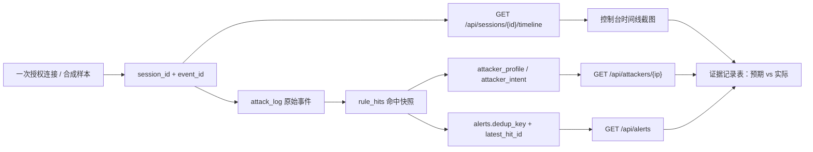

# 测试计划与验收矩阵（test-plan.md）

| 项目 | 内容 |
| --- | --- |
| 文档用途 | 定义数据库蜜罐系统的测试范围、测试矩阵、分层测试覆盖点、SC-001–SC-015 验收映射、证据记录方式与已知限制 |
| 目标读者 | 测试执行人、答辩演示者、课程报告撰写人、代码评审者 |
| 测试对象 | MySQL 8.0.46 实例、诱饵服务（3307）、FastAPI（8000）、Vue 控制台（8000 或 5173）、CLI 脚本 |
| 与其他文档的关系 | 测试步骤与命令大量复用 `specs/001-database-honeypot/quickstart.md` 的 V01–V23；现场流程见 [demo-script.md](demo-script.md)；索引专项见 [explain-indexes.md](explain-indexes.md)；架构与数据库设计见 [architecture.md](architecture.md)、[database-design.md](database-design.md) |
| 当前基线 | 2026-11-19 15:10 UTC 的仓库与运行实例；数据库统计随演示流量变化 |

> **状态声明**：截至 2026-11-19 15:10 UTC，`backend/tests/` 共收集 **225 个用例**：
> 单元 142、集成 39、接口 42、冒烟 2。单元/集成用例覆盖规则、风险、SQL 归一化、迁移、约束、
> 幂等、事务回滚、四视图、分析流水线；接口用例覆盖 11 个契约接口的健康检查、概览、趋势、
> 攻击者、会话、告警、规则。**当前运行限制**：多个进程并发运行 `pytest` 会争用同一个
> `honeypot_test`，导致迁移/夹具失败（`attack_log` 在迁移中途被另一进程清理等）；必须在
> 独占测试库的串行环境复跑。本文的“已验证”优先指在独占环境观察到通过，未覆盖的项用
> “手工已验证/待验证/未执行”明确区分。

---

## 1. 测试策略

### 1.1 测试分层

| 层级 | 目标 | 运行方式 | 数据库 | 当前状态 |
| --- | --- | --- | --- | --- |
| 单元测试 | 规则纯函数、风险评分、SQL 归一化、掩码、事件构造、伪造目录 | `pytest tests/unit`（142 用例） | 不连库（但会话级夹具会准备测试库） | 已实现；单文件运行可稳定通过 |
| 集成测试 | 约束、外键、幂等、事务回滚、视图、迁移往返 | `pytest tests/integration`（39 用例） | 真实 MySQL，**不使用 Mock** | 已实现；需独占测试库串行运行 |
| 接口测试 | 11 个 API 的状态码、分页、排序、错误码、脱敏 | `pytest tests/api`（42 用例）+ `httpx.ASGITransport` | `honeypot_test` | 已实现；需独占测试库串行运行 |
| 端到端/验收 | 连接诱饵、时间线、四页、重置、连续三轮 | 手工按 quickstart V01–V23 | `honeypot_dev`/`honeypot_demo` | 部分已验证 |
| 安全用例 | 注入载荷、超长输入、只存不执行、权限矩阵 | 接口 + SQL + 客户端 | 隔离实例 | 部分已验证 |

### 1.2 测试证据链



**原则**：每个验收结论都必须落到一个可复查的 `session_id` 或 `event_id`，截图/JSON 与 SQL
结果同时保存；不允许只写“页面看起来正常”。

### 1.3 环境准备

```bash
set -a; source .env; set +a
API=http://127.0.0.1:8000

# 数据库（若未启动）
docker compose up -d mysql && make migrate && make seed

# 三个进程（分别开终端）
make honeypot     # 3307
make api          # 8000
make frontend-build   # 或 make dev（5173）

# 健康检查
curl -s "$API/api/health" | jq
```

**基线断言**：`status=ok`、`database.status=ok`、`honeypot.status=up`；3306/3307/8000 均只监听
`127.0.0.1`。若任一条件不满足，先按 quickstart 第 9 章排障，不继续执行用例。

---

## 2. 测试矩阵（八类）

| # | 测试类 | 操作 | 预期结果 | 关键证据 | 当前状态 |
| --- | --- | --- | --- | --- | --- |
| T-01 | 连接 | 用 MySQL CLI/PyMySQL 连接 `127.0.0.1:3307`，重复 3 次 | 握手成功；每次产生新 `session_id` 与 `connect` 事件；客户端不崩溃 | 客户端输出、3 个 `session_id`、`attack_log` 查询 | 已验证：容器内 mysql 客户端连续 3 轮 `SHOW DATABASES/SHOW TABLES/DESCRIBE/SELECT` 均退出码 0 |
| T-02 | 失败认证 | 用未知虚构账号连接，再用预置账号 `demo_reader` 连接 | 未知账号返回 `1045` 且记录 `auth(status=failure)`；预置账号成功并记录 `auth(success)`；无口令字段入库 | `attack_log` 的 `username/status/credential_test_id` | 已验证：`no_such_user` 返回 `ERROR 1045`，库中记录 `auth/failure` 与 `credential_test_id` |
| T-03 | 踩点 | `SHOW DATABASES; USE honeypot_shop; SHOW TABLES; DESCRIBE users; SELECT ...` | 返回伪造库/表；命中 R03（recon，+15）；时间线可见对应事件 | `rule_hits` 中 `rule_code=R03`、`evidence_summary` | 已验证（R03 命中 5 次） |
| T-04 | 拖库 | 导入 S03 样本（同会话连续 SELECT、累计 1000 行）或真实客户端重复 SELECT | 命中 R04（data_dump，+25）；生成 `data_dump` 告警（high）；风险分上升 | `rule_hits` R04、`alerts.alert_type=data_dump` | 已验证：S03 会话 8 条事件、命中 R04，告警类型 `data_dump/high` 已存在 |
| T-05 | 破坏 | 依次执行 `UPDATE/DELETE/DROP/TRUNCATE/INSERT`，或导入 S04 样本（DROP 被拒） | 均返回 `1142`；连接不断；命中 R05（destructive，+35）；生成 `critical` 告警；伪造数据未被修改 | `attack_log.status=denied`、`rule_hits` R05、告警记录 | 已验证：S04 会话命中 R05；告警类型 `destructive/critical` 已存在 |
| T-06 | 画像 | 同一 IP 建立多个会话，执行连接/认证/查询 | `attacker_profile` 的连接数、认证尝试、查询数、首末时间与事件一致；风险分按规则权重重算一致 | API `/api/attackers/{ip}` 与 `v_attacker_profile_summary` 对照 | 已验证：127.0.0.1 画像（连接 2、认证 2、查询 11、风险 50）与事件聚合、视图一致 |
| T-07 | 界面 | 打开概览/攻击者/详情/告警四页；筛选、翻页、标记已读 | 数字与视图一致；空数据为空态；筛选结果与 SQL 一致；已读更新成功 | 四页截图、接口响应、`alerts.is_read` | 部分：四页已构建并由 8000 托管；接口可用；空态与筛选待逐项复测 |
| T-08 | 恢复 | `reset_demo --yes` 后核对规则/诱饵保留、观测表清空；再导入样本 | 6 张观测表为 0；`detection_rules=5`、`fake_users=30`、`fake_orders=120`、`fake_config=5`；可重复三轮 | 重置 JSON、前后计数 SQL、三轮结果对照 | 未执行（会清空当前演示数据；演示前执行） |

### 2.1 T-01/T-02 命令模板

```bash
# 失败认证（口令交互输入，使用未知虚构用户名）
mysql -h 127.0.0.1 -P 3307 -u no_such_user -p \
      --default-auth=mysql_native_password --ssl-mode=DISABLED \
      -e "SELECT 1;" ; echo "exit=$?"

# 成功认证（口令见 .env 的 HONEYPOT_ACCOUNTS，TEST-ONLY 虚构值）
mysql -h 127.0.0.1 -P 3307 -u demo_reader -p \
      --default-auth=mysql_native_password --ssl-mode=DISABLED \
      --default-character-set=utf8mb4 \
      -e "SHOW DATABASES; USE honeypot_shop; SHOW TABLES; DESCRIBE users;
          SELECT id, username, email FROM users LIMIT 5;"
```

**核对 SQL**：

```sql
SELECT session_id, source_ip, session_status, request_count, max_risk_score
FROM sessions ORDER BY started_at DESC LIMIT 3;

SELECT event_id, session_id, event_type, status, username, credential_test_id,
       LEFT(sql_statement, 60) AS sql_head, returned_rows
FROM attack_log ORDER BY event_id DESC LIMIT 20;
```

### 2.2 T-04 真实客户端触发 R04（无样本脚本时）

R04 种子阈值为 `min_consecutive_select=5` 或会话累计返回行数 `>1000`（数据库
`detection_rules.parameters_json` 实测值；代码缺省回退为 10/500）。在**同一连接**内重复
`SELECT` 直到累计返回行数超过 1000（`fake_orders` 有 120 行，约 9 次即可）：

```sql
SELECT COUNT(*) FROM orders;          -- 120
SELECT * FROM orders LIMIT 200;       -- 每次最多返回 120 行（协议单次上限 100 行）
-- 重复执行 >= 10 次，累计返回行数 >1000
```

> 注意：诱饵层单次查询返回行数上限为 100（`MAX_ROWS_RETURNED`），因此需要多次查询累计。

### 2.3 T-08 重置核对

```bash
cd backend && .venv/bin/python -m app.cli.reset_demo --yes
```

```sql
SELECT (SELECT COUNT(*) FROM sessions)         AS sessions,
       (SELECT COUNT(*) FROM attack_log)       AS events,
       (SELECT COUNT(*) FROM rule_hits)        AS hits,
       (SELECT COUNT(*) FROM alerts)           AS alerts,
       (SELECT COUNT(*) FROM attacker_profile) AS profiles,
       (SELECT COUNT(*) FROM detection_rules)  AS rules,
       (SELECT COUNT(*) FROM fake_users)       AS fake_users,
       (SELECT COUNT(*) FROM fake_orders)      AS fake_orders,
       (SELECT COUNT(*) FROM fake_config)      AS fake_config;
-- 期望：前 5 列为 0；rules=5、fake_users=30、fake_orders=120、fake_config=5
```

---

## 3. 分层测试覆盖点

### 3.1 单元测试（`tests/unit/`，已实现）

**当前用例文件**：`test_risk.py`（风险分/等级边界）、`test_rules.py`（R01–R05 正反例与阈值边界）、
`test_sql_norm.py`（SQL 归一化/注释剥离/首关键词）、`test_masking.py`（脱敏）、
`test_event_builder.py`（事件构造与截断）、`test_fake_catalog.py`（伪造目录投影）。

| 模块 | 覆盖点 | 期望 |
| --- | --- | --- |
| `app/services/risk.py` | 无命中/单规则/多规则/同规则重复命中/封顶 100/未知意图 | 确定性分数；同规则只计一次；≤100 |
| `app/services/risk.py` | `risk_level` 边界 0/29/30/59/60/79/80/100 | low/medium/high/critical 左闭右开 |
| `app/services/rules/r01`–`r05` | 正例、反例、阈值边界（=N 与 N-1）、窗口外事件 | 命中/不命中符合 data-model 10.2 |
| `app/services/rules/r03` | `DESC ` 尾空格、`ORDER BY x DESC` 不误报、大小写 | 只对元数据探测命中 |
| `app/services/rules/r05` | 首关键词、词边界、`status=denied`、`UPDATE_TIME` 不误报 | 写操作尝试命中 |
| `app/utils/sql.py` | 注释剥离、空白折叠、字面量占位、超长输入 | 归一化稳定、不执行 SQL |
| `app/utils/masking.py` | 用户名/凭据掩码 | 不泄露完整值 |
| `app/services/risk.py` | 输入为 ORM/字典/摘要对象 | 结果一致 |

### 3.2 集成测试（`tests/integration/`，已实现，真实 MySQL `honeypot_test`）

**当前用例文件**：`test_migrations.py`（11 表/4 视图/索引/生成列/种子/类型/字符集）、
`test_constraints_fk.py`（外键/唯一/CHECK）、`test_idempotency.py`（event_uuid 幂等）、
`test_transaction_rollback.py`（事务回滚与重试）；另有 `tests/test_smoke.py`（测试库与入库冒烟）。

| 场景 | 关键断言 |
| --- | --- |
| 外键拦截 | 向 `attack_log` 插入不存在的 `session_id` → `1452` |
| CHECK 约束 | `max_risk_score=101`、`severity='fatal'`、`ended_at<started_at` → `3819` |
| 唯一约束 | 同一 `event_uuid` 插入两次 → 第二次 `1062`，行数不变 |
| 快照一致性 | `rule_hits(event_id,session_id)` 必须同源；`rule_code/intent_type/risk_weight` 与规则行对应 |
| 事务回滚 | 注入画像/告警写入失败 → 5 类表计数与事务前一致；重试成功 |
| 重置事务 | 按外键顺序清空 6 表，规则与诱饵保留；中途失败整体回滚 |
| 视图 | 4 个视图可查；会话/画像重算分与明细聚合一致；无 JOIN 放大 |
| 迁移 | `alembic upgrade head` → `downgrade base` → `upgrade head` 往返通过 |
| 幂等 | 重复导入固定样本 10 次，日志数/计数/风险贡献与 1 次相同 |

### 3.3 接口测试（`tests/api/`，已实现，httpx + ASGITransport）

**当前用例文件**：`test_health.py`、`test_overview.py`、`test_trend.py`、`test_attackers.py`、
`test_sessions.py`、`test_alerts.py`、`test_rules.py`，共 42 个用例。

| 接口 | 覆盖点 |
| --- | --- |
| `GET /api/health` | 200 正常 / 503 数据库不可用结构；`X-Request-ID` 响应头 |
| `GET /api/overview` | 空库全 0；数字与两条视图 SQL 一致 |
| `GET /api/attackers` | 分页、排序白名单、`risk_level`/`intent_type` 筛选、空数组 |
| `GET /api/attackers/{ip}` | 正常详情、`ATTACKER_NOT_FOUND`、`IP_FORMAT_INVALID` |
| `GET /api/sessions/{id}/timeline` | 事件 `event_time,event_id` 稳定排序、404 `SESSION_NOT_FOUND`、口令脱敏 |
| `GET /api/alerts` | 类型/等级/已读/时间筛选、分页、空数组 |
| `PATCH /api/alerts/{id}` | 已读幂等、404、422；返回值来自数据库实际状态 |
| `GET/PATCH /api/rules` | 版本 +1、`expected_version` 冲突 409、空体 422、历史命中快照不变 |
| `GET /api/trend` | 连续日期补齐、`days` 边界、首行 delta 为 null |
| `GET /api/rules/effectiveness` | 排名、未命中规则仍返回 |
| 错误结构 | `code/message/detail/request_id` 恒在；状态码映射唯一 |
| 安全 | 响应不含明文口令；超长/畸形参数返回 422 而非 500 |

### 3.4 手工端到端（quickstart V01–V23）

直接按 `specs/001-database-honeypot/quickstart.md` 第 6 章执行。重点场景：

| 场景 | 内容 | 对应测试类 |
| --- | --- | --- |
| V02 | 连接 + 元数据查询（3 次） | T-01/T-03 |
| V03 | 未知账号认证失败 | T-02 |
| V04–V09 | 五条规则固定样本/真实流量 | T-03/T-04/T-05 |
| V06 | 会话时间线 | T-01/T-03 |
| V10–V13 | 概览/列表/详情/告警 | T-06/T-07 |
| V16 | 幂等重复导入 | T-08 前提 |
| V17–V18 | 外键/事务回滚 | 数据库专项 |
| V19 | 四视图查询 | T-07 |
| V20 | EXPLAIN 对比 | 索引专项 |
| V21–V22 | 重置与连续三轮 | T-08 |

---

## 4. SC-001–SC-015 验收映射

> “状态”列为 2026-11-19 手工核对结果；“待验证”表示尚未具备执行条件或未执行，
> 不得在答辩中宣称已通过。

| 成功标准 | 内容摘要 | 验证步骤/命令 | 预期结果 | 当前状态 |
| --- | --- | --- | --- | --- |
| **SC-001** | 授权客户端可连接诱饵并完成握手，连续三次成功 | `for i in 1 2 3; do docker run --rm --network host ... mysql -e "SELECT 1"; done` | 3 次均成功，产生 3 个新 `session_id` | 已验证：容器内 mysql 客户端连续 3 轮元数据查询均退出码 0；健康检查 `honeypot=up` |
| **SC-002** | 连接/认证/SQL 事件全部入库，关键字段无缺失 | `SELECT COUNT(*), SUM(... IS NULL) FROM attack_log;` | 必填字段无 NULL；事件类型/状态在枚举内 | 已验证：当时快照 2017 行，`event_uuid/session_id/event_type/source_ip/event_time/status` 无空值；`event_uuid` 无重复（后续演示流量会继续增加行数） |
| **SC-003** | 任选会话可在控制台还原顺序，与数据库逐条一致 | `GET /api/sessions/{id}/timeline` + 直接 SQL | 事件按 `event_time,event_id` 升序；字段一致 | 已验证：会话 `0046e73d-...` 时间线 10 条与 SQL 一致 |
| **SC-004** | 五条规则各有固定样本稳定触发，重复执行一致 | `cd backend && .venv/bin/python -m app.cli.import_samples --set demo_basic` | R01–R05 各有命中；固定样本事件数/命中与 README 预期一致 | 已验证：S01→R03、S02→R02、S03→R04、S04→R05、S05→R01，S06→R02+R04+R05（85 分）；S07 覆盖阈值边界 |
| **SC-005** | 画像连接数/查询数/首末时间/风险分与聚合一致 | `GET /api/attackers/127.0.0.1` + `v_attacker_profile_summary` | 计数与事件一致；`risk_score=calculated_risk_score` | 已验证（快照）：127.0.0.1 连接 2、认证 2、查询 11、风险 50，与事件计数/视图一致 |
| **SC-006** | 爆破/拖库/破坏样本生成告警，证据可追溯 | `alerts.latest_hit_id → rule_hits.hit_id → attack_log.event_id` | 告警类型/等级正确；证据链可查 | 已验证：`bruteforce/medium`、`data_dump/high`、`destructive/critical` 三类告警均存在；`latest_hit_id` 可回查命中与事件 |
| **SC-007** | 展示与导出 100% 无真实 PII/口令/可用内网信息 | 诱饵数据抽样 + 接口响应全文检索 | 只出现 `TEST-ONLY`/保留域名/掩码 | 部分：种子 CHECK 已强制 `TEST-ONLY`；列级授权与全量导出审计待验证 |
| **SC-008** | 演示脚本连续执行三次结果一致 | V22 循环 3 轮 | 三轮概览/画像/风险分一致，无人工修补 | 未执行：`reset_demo` 会清空当前数据，需在演示前执行 |
| **SC-009** | 四页在预置数据与空数据下均可用，数字与视图一致 | V10–V13、V21 | 空态正常；数字与视图 SQL 一致 | 部分：四页已构建并由 8000 托管，接口可用；空态/筛选待逐项复测 |
| **SC-010** | 四个视图均被使用，各有可执行演示查询 | V19 四条 SQL | 四条查询均成功 | 已验证：四视图在采集时点分别 201/1/2/5 行；4 条演示查询执行成功（行数随演示流量变化） |
| **SC-011** | 重复提交同一事件 10 次效果与 1 次相同 | `import_samples --sample S01 --repeat 10` + `GROUP BY event_uuid` | 日志/计数/风险贡献不变；无重复 `event_uuid` | 部分验证：数据层面固定样本会话事件数与预期一致、库中无重复 `event_uuid`；`tests/integration/test_idempotency.py` 用例已实现，待独占环境复跑（39 个集成用例之一） |
| **SC-012** | 写事务注入失败后五类数据一致且可重试 | `python -m app.cli.verify_transaction --inject-failure profile_write` | 五表计数前后一致；退出码 0；重试成功 | 部分验证：`tests/integration/test_transaction_rollback.py` 用例已实现，待独占环境复跑；CLI 现场演示未执行 |
| **SC-013** | 至少两组高频查询索引前后计划变化 | `cd backend && .venv/bin/python -m app.cli.explain_diff`；见 [explain-indexes.md](explain-indexes.md) | `type/key/rows/耗时` 有明确差异 | 已验证：JSON 记录 Q1 `ALL→ref`（2174→16 行）、Q2 `ALL→ref`（9→3 行），`filesort` 均消除 |
| **SC-014** | 本机页面查询与画像刷新在可接受时间内完成 | 浏览器 Network + `curl -w '%{time_total}'` | 建议 p95 < 500 ms；操作后及时刷新 | 部分：接口本机响应快；未做 20 次采样与页面计时 |
| **SC-015** | 可从迁移/种子/视图/索引在另一台机器完整重建 | 空库 `alembic upgrade head` + `seed` + 启动 | 11 表/4 视图/种子行数一致；演示可复现 | 未执行：需第二台实验机或全新库演练 |

### 4.1 证据记录模板

每次测试建议填写下表（可复制到课程报告附录）：

| 字段 | 填写规则 |
| --- | --- |
| 用例编号 | T-01…T-08 / V01…V23 / SC-001…SC-015 |
| 版本与环境 | 代码提交号、MySQL `VERSION()`、Python/Node 版本、浏览器 |
| 起始状态 | 空库/预置数据/已重置；关键表计数 |
| 操作与参数 | 客户端命令、SQL、接口 URL 与参数 |
| 预期结果 | 来自本文或 quickstart 的预期 |
| 实际结果 | 通过的断言与失败信息（含错误码） |
| 证据编号 | `session_id`、`event_id`、`alert_id`、`rule_hits.hit_id` |
| 截图/文件 | 命名规则见 4.2；记录相对路径 |
| 结论 | 通过 / 未通过 / 未执行（未执行须写原因与复测条件） |

### 4.2 会话/事件编号与截图位置

- 证据主键优先使用 `session_id`（UUID）与 `event_id`（自增），告警使用 `alert_id` +
  `latest_hit_id`；在 SQL 与截图中同时标出。
- 截图建议命名：`SC-004_R03-rule-hit_20261119T1445Z.png`；存放目录建议 `docs/evidence/`
  （**当前仓库尚未创建该目录**，由测试执行人按需建立，不要把大图提交进主分支）。
- 录屏建议命名：`demo_full_20261119.mp4`；与演示脚本同一版本。
- 接口响应可保存为 JSON：`curl -s ... > SC-010_views.json`，与 SQL 输出一并归档。

---

## 5. 数据库专项验证（摘要）

完整命令与预期见 [demo-script.md](demo-script.md) 第 5 章与 quickstart V17–V20。

| 项目 | 操作 | 期望 |
| --- | --- | --- |
| 外键拦截 | 插入引用不存在 `session_id` 的 `attack_log` | `ERROR 1452`，表行数不变 |
| CHECK 约束 | 写 `max_risk_score=101` / `severity='fatal'` | `ERROR 3819` |
| `event_uuid` 幂等 | 同一 `event_uuid` 插入两次 | 第二次 `ERROR 1062`，仅 1 行 |
| 事务回滚 | `verify_transaction --inject-failure profile_write` | 五表计数前后一致，重试成功 |
| 告警去重 | 固定样本重复导入 | `alert_id` 不变，`occurrence_count` +1 |
| 四视图 | V19 四条查询 | 均成功；分值与明细一致 |
| EXPLAIN | 见 [explain-indexes.md](explain-indexes.md) | 两查询计划从 `ALL` 变为 `ref/range` |

---

## 6. 性能与稳定性观察

| 指标 | 目标（plan.md） | 观测方式 | 当前 |
| --- | --- | --- | --- |
| 单条事件入库 + 分析 | < 100 ms | `EventEmitter` 日志/计时 | 未系统测量 |
| 控制台只读接口 p95 | < 500 ms | `curl -w '%{time_total}'` 20 次 | 未系统采样；本机单次请求为毫秒级 |
| 诱饵握手/查询 | < 1 s | 客户端计时 | 未系统测量 |
| 演示规模 | 1 千–1 万事件 | `SELECT COUNT(*)` | 2026-11-19 快照约 2.3 千事件；随演示流量变化 |
| 连续三轮 | 三轮结果一致 | V22 | 未执行 |

> 课程项目不做高并发/压力测试；上述指标只用于说明“现场演示是否流畅”，不作为生产性能承诺。

---

## 7. 已知限制与风险

| # | 限制 | 影响 | 当前处理/待办 |
| --- | --- | --- | --- |
| 1 | 自动化套件对共享 `honeypot_test` 敏感 | 并发运行时迁移/夹具失败，结果不稳定 | 测试串行且独占测试库；失败时先 `DROP DATABASE honeypot_test` 重建再跑；当前共 225 个用例 |
| 2 | 多个进程并发运行 `pytest` 会争用同一个 `honeypot_test`，出现迁移/夹具失败 | 测试结果不稳定，可能误判为代码缺陷 | 测试必须串行；`honeypot_test` 被污染时 `DROP DATABASE honeypot_test` 后重建再跑 |
| 3 | 表级最小权限脚本未在本实例执行 | `audit_log` 仅追加、规则不可删、伪哈希列隐藏未在权限层生效 | 执行 `scripts/apply_table_grants.sh honeypot_dev` 后复验 `SHOW GRANTS` |
| 4 | 实际 MySQL 8.0.46，设计文档写 8.4 LTS | 认证插件默认行为、弃用告警略有差异 | 只使用两者共有能力；答辩说明实际版本 |
| 5 | 不使用数据库 Mock | 集成/接口测试必须依赖真实 MySQL | CI/实验机需先 `make db-up`；测试库 `honeypot_test` 与演示库分离 |
| 6 | 诱饵只支持 `mysql_native_password`，不支持 SSL/预处理/多语句 | 部分现代客户端/GUI 连接失败 | 固定演示客户端 PyMySQL/MySQL CLI 8.0；GUI 需关闭 SSL 并选 native |
| 7 | 错误码差异 | 客户端错误提示与真实 MySQL 不完全逐字一致（只保证错误码与行为类别） | 文档中按错误码断言（1045/1142/1148/1295/1062/1452/3819），不断言完整文案 |
| 8 | `gen_demo_data` 为批量插入，不触发规则分析 | 只有会话/事件，没有画像/命中/告警 | 仅用于 EXPLAIN 与规模演示；画像验证用真实流量或样本导入 |
| 9 | 视图实时聚合、无物化 | 数据量增长后页面变慢 | 演示规模内可接受；页面查询带 LIMIT |
| 10 | AI 默认关闭 | `/api/ai/ask` 返回服务不可用 | 属可选增强，不影响核心闭环；开启时只走白名单只读模板 |
| 11 | 前端 hash 路由 | URL 形如 `/#/attackers` | 由 `createWebHashHistory` 决定，静态托管无需 SPA 回退 |
| 12 | 演示重置会清空观测数据 | 当前手工测试数据会被删除 | 演示前执行并重新生成；准备干净副本与录屏 |

---

## 8. 相关文档

- [system architecture](architecture.md)：分层、数据流、部署与安全边界。
- [database-design.md](database-design.md)：ER、约束、视图、事务、账号与迁移。
- [demo-script.md](demo-script.md)：现场 7 步演示与数据库专项操作。
- [explain-indexes.md](explain-indexes.md)：两条高频查询的 EXPLAIN 实测与复现。
- `specs/001-database-honeypot/quickstart.md`：V01–V23 可复制命令与 SC 映射（本文的上游）。
- `specs/001-database-honeypot/spec.md`：SC-001–SC-015 定义与边界情况。
- `specs/001-database-honeypot/contracts/api.md`：接口错误码与分页/排序契约。
