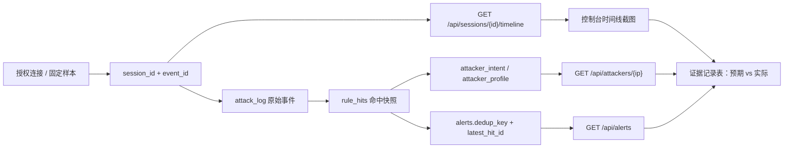

# 测试计划与验收矩阵（test-plan.md）

| 项目 | 内容 |
| --- | --- |
| 文档用途 | 定义模块化重构后的测试范围、真实用例统计、分层覆盖点、001 行为矩阵与 SC 映射、**002 验收场景**（结构/边界/契约/交互/视觉/部署/回归）、证据记录方式与已知限制 |
| 目标读者 | 测试执行人、答辩演示者、课程报告撰写人、代码评审者 |
| 测试对象 | 容器 MySQL（`dbhoneypot-mysql`）、M2 诱饵服务 `:3307`、M1 FastAPI `:8000`、M5 控制台（`frontend/dist` 由后端托管）、M3 约束测试、判定工具链 |
| 与其他文档的关系 | 现场流程见 [demo-script.md](demo-script.md)；结构/依赖见 [architecture.md](architecture.md)；部署与 13 步验收见 [deployment.md](deployment.md)；数据库对象见 [database-design.md](database-design.md)；上游规格 `specs/002-ui-console-modularization/quickstart.md` |
| 当前基线 | 2026-11-25（模块化重构后仓库与运行实例）；数据库统计随演示流量变化 |

> **状态声明**：截至 2026-11-25，用例数量以实际 `pytest --collect-only` 为准，不再手抄：
>
> | 收集方式 | 用例数 | 说明 |
> | --- | --- | --- |
> | `pytest`（仓库默认 `testpaths = tests, shared/tests, modules`） | **270** | 单元 / 集成 / 接口 / 结构-所有权门禁（按目录归类） |
> | `make test`（`tests shared/tests modules shared/deploy/tests`） | **300** | 在 270 基础上追加 `shared/deploy/tests` 的 30 个检查器单测 |
>
> ```bash
> export PYTHONPATH=.:modules/m1-transaction-integration:modules/m2-decoy-capture:\
> modules/m4-rules-derived:modules/m5-views-console
> PY=/tmp/dbh-venv/bin/python        # 或仓库 .venv/bin/python / make 的 $(PY)
> "$PY" -m pytest --collect-only -q | tail -1          # 270 tests collected
> "$PY" -m pytest --collect-only -q tests shared/tests modules shared/deploy/tests | tail -1  # 300
> ```
>
> **运行限制**：根 `conftest.py` 只准备一个 `honeypot_test` 库，因此同一时刻只运行一个
> `pytest` 进程；并发运行会争用测试库导致迁移/夹具失败。本文中“已验证”指在独占环境
> 观察到通过，“部分/待复跑/未执行”均显式标注，不得在答辩中当作已通过。

---

## 1. 测试策略

### 1.1 测试分层（数字来自 2026-11-25 实际收集）

| 层级 | 目标 | 运行方式 | 数据库 | 用例数 |
| --- | --- | --- | --- | --- |
| 单元测试 | 规则判定、风险评分、SQL 归一化、脱敏、事件构造、伪造目录、结构/边界检查器 | `pytest`（`modules/m4-rules-derived/tests/unit`、`shared/tests/unit`、`modules/m2-decoy-capture/tests/unit`、`shared/deploy/tests`） | 规则/工具类不连库 | 141（业务单元）+ 30（检查器） |
| 集成测试 | 迁移往返、约束/外键、幂等、事务回滚、四视图、分析流水线 | `pytest`（`modules/*/tests/integration`） | 真实 MySQL `honeypot_test`，**不使用 Mock** | 39 |
| 接口测试 | 契约接口的状态码、分页、排序、错误码、脱敏、002 扩展端点 | `pytest`（`modules/m1.../tests/api`、`modules/m4.../tests/api`）+ `httpx.ASGITransport` | `honeypot_test` | 82 |
| 浏览器/交互验收 | 四页 × 两视口的 console/请求/溢出/字体/标题/favicon/导航/已读 PATCH | `make verify`（`verify/run-check.mjs`） | `honeypot_dev` 固定种子 | 由脚本断言，不计入 pytest |
| 视觉验收 | 令牌审计 + 两视口四页截图 + 区域清单 | `make verify2`、`make token-audit`、`make capture` | 同上 | 同上 |
| 部署验收 | 13 步真实部署路径（构建产物 → 后端托管 → 浏览器 → 降级 → 证据） | `make verify` / `make verify3` | 同上 | 同上 |
| 手工端到端 | 诱饵连接、四页操作、降级、批量已读、重置 | 按 [demo-script.md](demo-script.md) 执行 | `honeypot_dev` | 不计入 |

**目录分布**（`pytest --collect-only` 实测）：

| 目录 | 用例数 |
| --- | --- |
| `modules/m1-transaction-integration/tests` | 93 |
| `modules/m4-rules-derived/tests` | 70 |
| `shared/tests` | 66 |
| `shared/deploy/tests` | 30（仅 `make test`） |
| `modules/m2-decoy-capture/tests` | 16 |
| `modules/m3-er-constraints/tests` | 13 |
| `modules/m5-views-console/tests` | 4 |
| 根 `tests/` | 0（仅放 `support.py` 等跨模块夹具支撑） |

### 1.2 证据链



**原则**：每个验收结论都落到可复查的 `session_id` / `event_id` / `alert_id`，
截图与 JSON/SQL 输出同时保存；不允许只写“页面看起来正常”。

### 1.3 环境准备

```bash
cp -n .env.example .env
make db-up && make migrate && make seed          # 容器 MySQL + 固定种子数据
make frontend-build                              # 控制台产物（后端托管）
make api                                         # 终端 A：uvicorn :8000
make honeypot                                    # 终端 B：诱饵 :3307（浏览器/端到端用例需要）
make test                                        # 终端 C：全仓 pytest（独占运行）
```

**基线断言**：`curl -s http://127.0.0.1:8000/api/health` 返回 200 且
`status=ok`、`database.status=ok`；3306/3307/8000 只监听 `127.0.0.1`。任一不满足先排障，
不继续执行用例。

---

## 2. 测试矩阵（001 行为基线，八类）

> 下列行为验证的核心断言不因模块搬迁而改变；命令已改为新布局路径。
> “状态”列保留 001 期（2026-11-19）的实测结论，新增/变化项在 002 章节单独给出。

| # | 测试类 | 操作 | 预期结果 | 关键证据 | 状态 |
| --- | --- | --- | --- | --- | --- |
| T-01 | 连接 | 用 MySQL 客户端/模拟器连接 `127.0.0.1:3307`，重复 3 次 | 握手成功；每次产生新 `session_id` 与 `connect` 事件；客户端不崩溃 | 客户端输出、3 个 `session_id`、`attack_log` 查询 | 001 已验证（容器内 mysql 客户端 3 轮元数据查询退出码 0） |
| T-02 | 失败认证 | 未知虚构账号连接，再用 `.env` 预置账号连接 | 未知账号 `1045` 且记录 `auth(failure)`；预置账号 `auth(success)`；无口令字段入库 | `attack_log.username/status/credential_test_id` | 001 已验证 |
| T-03 | 踩点 | `SHOW DATABASES; USE honeypot_shop; SHOW TABLES; DESCRIBE users; SELECT ...` | 返回伪造库/表；命中 R03（recon，+15）；时间线可见对应事件 | `rule_hits.rule_code=R03`、`evidence_summary` | 001 已验证；002 下仍由 `simulate_traffic` 覆盖 |
| T-04 | 拖库 | 导入 S03（同会话连续 SELECT、累计 1000 行）或真实客户端重复 SELECT | 命中 R04（data_dump，+25）；`data_dump` 告警（high） | `rule_hits` R04、`alerts.alert_type=data_dump` | 001 已验证 |
| T-05 | 破坏 | `UPDATE/DELETE/DROP/TRUNCATE/INSERT` 或 S04 样本 | 均返回 `1142`；连接不断；命中 R05（destructive，+35）；`critical` 告警；伪造数据未变 | `attack_log.status=denied`、R05、告警 | 001 已验证 |
| T-06 | 画像 | 同一 IP 多会话，执行连接/认证/查询 | 画像计数与事件一致；风险分按规则权重重算一致 | `/api/attackers/{ip}` 与 `v_attacker_profile_summary` 对照 | 001 已验证（快照） |
| T-07 | 界面 | 四页 + 筛选/翻页/已读 | 数字与视图一致；空数据空态；筛选真实生效；已读更新成功 | 四页截图、接口响应、`alerts.is_read` | 002 改为脚本断言：见 §3 |
| T-08 | 恢复 | `make reset-demo` 后核对规则/诱饵保留、观测表清空；再导入样本 | 6 张观测表为 0；`detection_rules=5`、`fake_users=30`、`fake_orders=120`、`fake_config=5`；可重复三轮 | 重置 JSON、前后计数 SQL、三轮对照 | 001 未执行（会清空演示数据）；002 由 `make seed` 与 `make verify3` 覆盖 |

### 2.1 命令模板（新布局）

```bash
export PYTHONPATH=.:modules/m1-transaction-integration:modules/m2-decoy-capture:\
modules/m4-rules-derived:modules/m5-views-console
PY=/tmp/dbh-venv/bin/python      # 或 .venv/bin/python

# 授权模拟器：真实 MySQL 协议连诱饵（读成功 + 写被 1142 拒绝）
"$PY" -m m2_decoy_capture.cli.simulate_traffic --target 127.0.0.1:3307 --rounds 3

# 固定样本（S01–S07 / demo_basic），重复导入幂等
"$PY" -m m2_decoy_capture.cli.import_samples --set demo_basic

# 演示数据重置（清空观测数据，保留规则与诱饵种子）
"$PY" -m m1_transaction_integration.cli.reset_demo --yes

# 事务验证（注入写入失败后核对五表一致、可重试）
"$PY" -m m1_transaction_integration.cli.verify_transaction --inject-failure profile_write

# 视图口径断言 + 数据库↔页面 API 抽样核对
"$PY" -m m5_views_console.cli.verify_views --check-pages --json
```

**核对 SQL**：

```sql
SELECT session_id, source_ip, session_status, request_count, max_risk_score
FROM sessions ORDER BY started_at DESC LIMIT 3;

SELECT event_id, session_id, event_type, status, username, credential_test_id,
       LEFT(sql_statement, 60) AS sql_head, returned_rows
FROM attack_log ORDER BY event_id DESC LIMIT 20;

SELECT (SELECT COUNT(*) FROM sessions)         AS sessions,
       (SELECT COUNT(*) FROM attack_log)       AS events,
       (SELECT COUNT(*) FROM rule_hits)        AS hits,
       (SELECT COUNT(*) FROM alerts)           AS alerts,
       (SELECT COUNT(*) FROM attacker_profile) AS profiles,
       (SELECT COUNT(*) FROM detection_rules)  AS rules,
       (SELECT COUNT(*) FROM fake_users)       AS fake_users,
       (SELECT COUNT(*) FROM fake_orders)      AS fake_orders,
       (SELECT COUNT(*) FROM fake_config)      AS fake_config;
```

### 2.2 分层覆盖点

| 层 | 用例文件（新路径） | 覆盖点 |
| --- | --- | --- |
| 单元·规则 | `modules/m4-rules-derived/tests/unit/test_rules.py`（37） | R01–R05 正反例、阈值 `=N`/`N-1`、窗口外事件、`DESC` 尾空格与 `ORDER BY x DESC` 不误报、写操作词边界、`status=denied` |
| 单元·评分 | `.../test_risk.py`（22） | 同规则只计一次、取最大权重、封顶 100、等级边界 0/29/30/59/60/79/80/100、输入为 ORM/字典/摘要对象结果一致 |
| 单元·共享 | `shared/tests/unit/test_sql_norm.py`（30）、`test_masking.py`（18）、`test_event_builder.py`（18） | 注释剥离/空白折叠/字面量占位/超长输入；用户名与凭据掩码；事件构造与截断 |
| 单元·诱饵 | `modules/m2-decoy-capture/tests/unit/test_fake_catalog.py`（16） | 伪造目录投影与真实表隔离 |
| 单元·门禁 | `shared/deploy/tests/test_check_boundaries.py`、`test_check_structure.py`、`test_offline_assets.py`（共 30） | 构造 8 类边界违规断言 `exit 1`、当前仓库 `exit 0`；结构检查旧布局/前缀/必需入口；构建产物零外链 |
| 集成·迁移 | `modules/m1-transaction-integration/tests/integration/test_migrations.py`（15） | 11 表/4 视图/索引/生成列/种子/类型/字符集；`upgrade → downgrade → upgrade` 往返 |
| 集成·约束 | `modules/m3-er-constraints/tests/integration/test_constraints_fk.py`（13） | 外键 `1452`、唯一 `1062`、CHECK `3819`、快照同源 |
| 集成·事务 | `.../test_idempotency.py`（2）、`test_transaction_rollback.py`（2） | `event_uuid` 幂等、注入失败后五表计数不变且可重试 |
| 集成·视图 | `modules/m5-views-console/tests/integration/test_views.py`（4） | 两来源三会话下四视图的计数与排序 |
| 集成·流水线 | `modules/m4-rules-derived/tests/integration/test_analysis_pipeline.py`（3） | 同一事务内规则→意图→画像→告警的端到端派生 |
| 接口 | `modules/m1.../tests/api/`（73）、`modules/m4.../tests/api/test_rules.py`（8） | 11 个既有接口 + 002 扩展端点（overview range、trend hit_*、alerts/summary、attackers/summary、q/sort、画像派生字段、422 统一格式） |

---

## 3. 002 验收场景（结构 / 边界 / 契约 / 交互 / 视觉 / 部署 / 回归）

| # | 场景 | 命令 | 期望 | 证据路径 | 当前状态 |
| --- | --- | --- | --- | --- | --- |
| A-01 | **结构**门禁 | `make structure` | 退出码 0；根必需文件、六组件 README/证据目录、包命名、必需入口、无旧布局残留、配置一致（`alembic.ini` / `.env.example` / `compose.yaml` / `Makefile` / `pyproject.toml`） | 终端 PASS/FAIL；实现 `shared/deploy/check_structure.py` | 可执行（本轮文档未复跑，结论以命令输出为准） |
| A-02 | **边界**门禁 | `make boundary` | 退出码 0；`violations == []`、`legacy_imports == []`；允许矩阵仅含 `M1→shared/M4.public`、`M2→shared/M1.public`、`M3→shared(tests/tools)`、`M4→shared`、`M5→shared(cli/tests)`、`shared→无` | 终端/JSON；单测 `shared/deploy/tests/test_check_boundaries.py` | 可执行；8 类违规样例由单测覆盖 |
| A-03 | **契约**·既有接口回归 | `make test`（接口层 82 例） | 11 个既有接口状态码/分页/排序/错误结构不变 | pytest 汇总；`modules/m1-transaction-integration/tests/api/` | 可执行 |
| A-04 | **契约**·002 扩展端点 | `"$PY" -m pytest modules/m1-transaction-integration/tests/api/test_api_extensions.py -q`（37 例） | overview `range` 窗口、trend `hit_*`、alerts/summary、attackers/summary、`q`/`sort` 白名单、画像派生字段、422 统一格式 | `modules/m1-transaction-integration/evidence/api-extensions.md`（EXPLAIN + HTTP 冒烟） | 已产出证据（2026-11-25） |
| A-05 | **契约**·视图口径 | `"$PY" -m m5_views_console.cli.verify_views --check-pages --json` | 16 条视图断言 + 21 条 DB↔API 核对全部 `ok=true`；退出码 0 | `modules/m5-views-console/evidence/sql-ui/verify-views.json`、`queries-output.txt`、`views/queries.sql` | 已产出证据；页面↔API 的已知差异见 checklist.md 组 2 |
| A-06 | **交互**·四页浏览器检查 | `make verify`（步骤 8：`verify/run-check.mjs`） | 四页 × 1440×900/1920×1080：`console_errors=0`、`failed_requests=0`、`http_errors=0`、`external_requests=0`、`horizontal_overflow=false`、字体就绪、title/favicon 正确、区域齐全、导航与已读 PATCH 通过 | `modules/m5-views-console/evidence/deploy/run-N/browser.json`、`screenshots/` | 最近一轮 `run-1` 页面级 8 项检查为 ok（console/http 错误 0），步骤 8 因导航检查失败中止；以最新 `run-N/deploy-record.json` 的 `result` 为准 |
| A-07 | **交互**·批量已读与部分失败 | 手工：`#/alerts` 勾选多条 → 批量标记；可选中途 `docker stop dbhoneypot-mysql` | 成功 toast `已标记 N 条告警为已读`；失败时 `部分成功：X 条已读，Y 条失败` 并列出前 3 条原因；失败条目不静默丢弃 | 浏览器手动；语义见 `specs/002-ui-console-modularization/contracts/ui-contracts.md` §6.4 | 待手工执行 |
| A-08 | **交互**·降级 | `docker stop dbhoneypot-mysql` → 刷新页面 → `docker start dbhoneypot-mysql` | `/api/health` 503 `status=degraded`；SPA 入口仍 200；页面显示横幅“数据库不可用或健康检查失败，以下为最近一次成功数据。”+ 重试；恢复后 200 | `evidence/deploy/run-N/deploy-record.json` 第 11 步 | 由 `make verify` 覆盖；最近一轮未跑到该步 |
| A-09 | **视觉**·令牌审计 | `make token-audit` | 0 违规：class/内联样式只使用 `frontend/tailwind.config.js` 中的颜色/字号/字体/间距/圆角；CSS 无裸颜色字面量 | `modules/m5-views-console/evidence/deploy/run-N/token-audit.json` | 脚本与 Makefile 目标已就绪；最近一轮于步骤 8 中止，token-audit 尚未落盘 |
| A-10 | **视觉**·两视口截图与区域清单 | `make verify2` | 四页 × 两视口截图落盘；区域核对表登记差异与一致率 | `evidence/visual/summary.md`（run-1 pass，区域 82/82）、`region-checklist.md` | 2026-11-25 通过 |
| A-11 | **视觉**·基线截图 | `make capture` | 产出 `{page}-{viewport}.png`（8 张）+ 元数据 | `evidence/visual/baseline/`（深色 8 张 + `metadata.json`） | 2026-11-25 通过 |
| A-12 | **部署**·13 步验收 | `make verify` | 1–13 步全部 PASS；退出码 0；证据目录完整（`deploy-record.json`、`browser.json`、`token-audit.json`、`backend.log`、截图、`summary.md`） | `evidence/deploy/run-1/`、`summary.md` | 2026-11-25 通过（13/13） |
| A-13 | **部署**·确定性 3 轮 | `make verify3` | 3 轮固定种子摘要一致（`stable`）；跨轮 `seed-digest` 相同 | `evidence/deploy/summary.md` 的“固定种子数据确定性”段 | 进行中：run-1 pass + digest 稳定，三轮由 `verify3` 归档 |
| A-14 | **回归**·全仓测试 | `make test` | 300 passed，0 failed；无 `honeypot_test` 污染错误 | pytest 汇总 | 2026-11-25 通过（默认 270 + 部署自测 30） |
| A-15 | **回归**·旧行为不回归 | `make test` + `simulate_traffic` + `import_samples --set demo_basic` | R01–R05 命中与告警映射、1142 拒绝、时间线、重置与幂等与 001 一致 | `modules/m5-views-console/evidence/sql-ui/checklist.md`、`modules/m2-decoy-capture/evidence/` | 可执行 |
| A-16 | **视觉**·深/浅双主题 | `node verify/token-audit.mjs` + `node verify/run-check.mjs --base-url http://127.0.0.1:8000 --out <dir>` | 深/浅两套令牌齐全且无裸色值；默认 `system` 跟随系统外观实时切换；按钮三态循环（跟随系统→浅色→深色）并持久化、刷新保持；浅色四页区域齐全、标题正确、无溢出与资源错误；深浅背景色不同 | `modules/m5-views-console/evidence/visual/theme-evidence.md`、`evidence/visual/baseline-light/`、`evidence/deploy/run-N/browser.json` 的 `interactions.theme`/`light_pages` | 2026-11-25 增补（FR-133/134） |

> 建议执行顺序：A-01 → A-02 → A-14（门禁与回归）→ `make db-up && make migrate && make seed`
> → A-04/A-05（契约与视图）→ A-12/A-13（部署与确定性）→ A-06/A-09/A-10/A-11（视觉与交互）
> → A-07/A-08（手工交互）→ A-15。

---

## 4. SC-001–SC-015 验收映射（001 基线）

> 状态列保留 001 期（2026-11-19）手工核对结果；命令与证据路径已更新到新布局。
> 标注“待复跑/未执行”的项不得在答辩中宣称已通过。

| 成功标准 | 内容摘要 | 验证步骤/命令 | 预期结果 | 状态 |
| --- | --- | --- | --- | --- |
| **SC-001** | 授权客户端可连接诱饵并完成握手，连续三次成功 | `"$PY" -m m2_decoy_capture.cli.simulate_traffic --rounds 3` | 3 次均成功，产生 3 个新 `session_id` | 已验证（模拟器等价路径） |
| **SC-002** | 连接/认证/SQL 事件全部入库，关键字段无缺失 | 见 §2.1 核对 SQL | 必填字段无 NULL；事件类型/状态在枚举内；`event_uuid` 无重复 | 已验证（001 快照 2017 行；后续流量继续增加） |
| **SC-003** | 任选会话可在控制台还原顺序，与数据库逐条一致 | `GET /api/sessions/{id}/timeline` + 直接 SQL | 事件按 `event_time,event_id` 升序；字段一致 | 已验证（001 会话 10 条一致） |
| **SC-004** | 五条规则各有固定样本稳定触发，重复执行一致 | `"$PY" -m m2_decoy_capture.cli.import_samples --set demo_basic` | S01→R03、S02→R02、S03→R04、S04→R05、S05→R01、S06→R02+R04+R05（85 分）、S07 阈值边界 | 已验证 |
| **SC-005** | 画像连接数/查询数/首末时间/风险分与聚合一致 | `GET /api/attackers/{ip}` + `v_attacker_profile_summary` | 计数与事件一致；`risk_score = calculated_risk_score` | 已验证（001 快照） |
| **SC-006** | 爆破/拖库/破坏样本生成告警，证据可追溯 | `alerts.latest_hit_id → rule_hits.hit_id → attack_log.event_id` | 等级映射 R02 medium / R04 high / R05 critical；证据链可查 | 已验证（三类告警存在） |
| **SC-007** | 展示与导出 100% 无真实 PII/口令/可用内网信息 | 诱饵数据抽样 + 接口响应全文检索 | 只出现 `TEST-ONLY`/RFC 5737 保留网段/掩码 | 部分：种子 CHECK 已强制；列级授权待验证 |
| **SC-008** | 演示脚本连续执行三次结果一致 | 按 [demo-script.md](demo-script.md) 三轮 | 三轮概览/画像/风险分一致，无人工修补 | `make verify3` 覆盖确定性摘要；完整演示三轮未执行 |
| **SC-009** | 四页在预置数据与空数据下均可用，数字与视图一致 | `make verify` + 空库手测 | 空态正常；数字与视图 SQL 一致 | 部分：四页已构建托管；空态/筛选逐项复测中 |
| **SC-010** | 四个视图均被使用，各有可执行演示查询 | `modules/m5-views-console/views/queries.sql` + `m5_views_console/cli/run_queries.py` | 四条查询均成功并落盘输出 | 已验证：`evidence/sql-ui/queries-output.txt` |
| **SC-011** | 重复提交同一事件 10 次效果与 1 次相同 | `import_samples --sample S01 --repeat 10`；`tests/integration/test_idempotency.py` | 日志/计数/风险贡献不变；无重复 `event_uuid` | 单测/集成已实现；现场重复导入待执行 |
| **SC-012** | 写事务注入失败后五类数据一致且可重试 | `"$PY" -m m1_transaction_integration.cli.verify_transaction --inject-failure profile_write` | 五表计数前后一致；退出码 0；重试成功 | 集成用例已实现；CLI 现场未执行 |
| **SC-013** | 至少两组高频查询索引前后计划变化 | `modules/m2-decoy-capture/docs/explain-indexes.md` + `evidence/explain/explain_20261119T145423Z.json` | Q1 `ALL→ref`（2174→16 行）、Q2 `ALL→ref`（9→3 行），`filesort` 消除 | 已验证（归档 JSON） |
| **SC-014** | 本机页面查询与画像刷新在可接受时间内完成 | 浏览器 Network + `curl -w '%{time_total}'` | 建议 p95 < 500 ms | 部分：单次毫秒级；未做 20 次采样 |
| **SC-015** | 可从迁移/种子/视图/索引在另一台机器完整重建 | 空库 `alembic upgrade head` + `make seed` + 启动 | 11 表/4 视图/种子行数一致；演示可复现 | 未执行（需第二台机器或全新库演练） |

### 4.1 证据记录模板

| 字段 | 填写规则 |
| --- | --- |
| 用例编号 | T-01…T-08 / A-01…A-15 / SC-001…SC-015 |
| 版本与环境 | 代码提交号、MySQL `VERSION()`、Python/Node/浏览器版本 |
| 起始状态 | 空库/固定种子/已重置；关键表计数 |
| 操作与参数 | CLI 命令、SQL、接口 URL 与参数 |
| 预期结果 | 来自本文或契约的预期 |
| 实际结果 | 通过的断言与失败信息（含错误码） |
| 证据编号 | `session_id`、`event_id`、`alert_id`、`rule_hits.hit_id` |
| 截图/文件 | 相对路径；部署/视觉证据放 `modules/m5-views-console/evidence/{deploy,visual,sql-ui}/` |
| 结论 | 通过 / 未通过 / 未执行（未执行须写原因与复测条件） |

### 4.2 截图与证据位置约定

- 四页基线：`modules/m5-views-console/evidence/visual/baseline/{page}-{viewport}.png`
  （`page ∈ overview, attackers, attacker-detail, alerts`；`viewport ∈ 1440x900, 1920x1080`），
  由 `make capture` 生成；索引见 [screenshots/README.md](screenshots/README.md)。
- 部署轮次：`modules/m5-views-console/evidence/deploy/run-N/`（`deploy-record.json`、
  `browser.json`、`token-audit.json`、`backend.log`、`screenshots/`、`seed-import.json`、`steps.tsv`）。
- 视图/页面核对：`modules/m5-views-console/evidence/sql-ui/`。
- 数据库对象实测：`modules/m3-er-constraints/evidence/{constraints.json,schema.svg,schema.png}`。
- 索引对比：`modules/m2-decoy-capture/evidence/explain/`。
- 不要提交大体积录屏；截图命名遵循上面的 `{page}-{viewport}.png` 约定。

---

## 5. 数据库专项验证（摘要）

| 项目 | 操作 | 期望 |
| --- | --- | --- |
| 外键拦截 | 插入引用不存在 `session_id` 的 `attack_log` | `ERROR 1452`，表行数不变 |
| CHECK 约束 | 写 `max_risk_score=101` / `severity='fatal'` | `ERROR 3819` |
| `event_uuid` 幂等 | 同一 `event_uuid` 插入两次 | 第二次 `ERROR 1062`，仅 1 行 |
| 事务回滚 | `verify_transaction --inject-failure profile_write` | 五表计数前后一致，重试成功 |
| 告警去重 | 固定样本重复导入 | `alert_id` 不变，`occurrence_count` +1 |
| 四视图 | `views/queries.sql` 四条查询 | 均成功；分值与明细一致 |
| 约束清单对账 | `tools/introspect_constraints.py` 与迁移逐条比对 | 漂移为 0（见 `constraints/catalog.md`） |
| EXPLAIN | `modules/m2-decoy-capture/docs/explain-indexes.md` | 两查询计划从 `ALL` 变为 `ref/range` |

---

## 6. 性能与稳定性观察

| 指标 | 目标（plan.md） | 观测方式 | 当前 |
| --- | --- | --- | --- |
| 单条事件入库 + 分析 | < 100 ms | `EventEmitter` 日志/计时 | 未系统测量 |
| 控制台只读接口 p95 | < 500 ms | `curl -w '%{time_total}'` 20 次 | 未系统采样；本机单次请求毫秒级 |
| 页面间切换 | ≤ 1 s | 浏览器手测 | 未系统测量 |
| 部署验收全流程 | ≤ 10 min | `make verify` 计时 | 最近一轮约 3 分钟（因步骤 8 中止，未含令牌审计与降级步骤） |
| 演示规模 | 1 千–1 万事件 | `SELECT COUNT(*)` | 交付口径 200 会话 / 2400 事件；随演示流量变化 |
| 连续三轮 | 三轮结果一致 | `make verify3` | 待执行 |

> 课程项目不做高并发/压力测试；上述指标只用于说明“现场演示是否流畅”，不作为生产性能承诺。

---

## 7. 已知限制与风险

| # | 限制 | 影响 | 处理/待办 |
| --- | --- | --- | --- |
| 1 | 根 `conftest.py` 只准备一个 `honeypot_test` | 并发 `pytest` 争用测试库，迁移/夹具失败 | 测试必须串行；污染时重建 `honeypot_test` 再跑 |
| 2 | 表级最小权限脚本未在本实例执行 | `audit_log` 仅追加、伪哈希列隐藏未在权限层生效 | 执行 `bash modules/m1-transaction-integration/db/grants/apply_table_grants.sh honeypot_dev` 后复验 `SHOW GRANTS` |
| 3 | 实际 MySQL 8.0.46，`compose.yaml` 注释提到 8.4 | 认证/保留字差异 | 只使用共有能力；答辩说明实际版本 |
| 4 | 不使用数据库 Mock | 集成/接口测试依赖真实 MySQL | 先 `make db-up`；测试库与演示库分离 |
| 5 | 诱饵只支持 `mysql_native_password`，不支持 SSL/预处理/多语句 | 部分客户端/GUI 连不上 | 固定用 8.0 客户端并关闭 SSL |
| 6 | 错误文案与真实 MySQL 不完全逐字一致 | 只能断言错误码 | 按 1045/1142/1148/1295/1062/1452/3819 断言 |
| 7 | `gen_demo_data` 批量插入不触发规则分析 | 只有会话/事件，无画像/命中/告警 | 仅用于规模与 EXPLAIN；画像验证用真实流量或样本 |
| 8 | 视图实时聚合、无物化 | 数据增长后页面变慢 | 演示规模内可接受；查询带时间上界与 LIMIT |
| 9 | AI 默认关闭 | `/api/ai/ask` 不可用 | 可选增强；开启时只走白名单只读模板 |
| 10 | 前端 hash 路由 | URL 形如 `/#/attackers` | 静态托管无需 SPA 回退；深链刷新正常 |
| 11 | 演示重置会清空观测数据 | 手工测试数据被删除 | 演示前执行并重新生成；准备干净副本与录屏 |
| 12 | M2 `explain_diff` CLI 仍把 JSON 写到仓库根 `db/explain/` | 与模块化证据目录不一致 | 归档证据以 `modules/m2-decoy-capture/evidence/explain/` 为准；重跑前先确认输出目录 |
| 13 | 浏览器验收依赖已构建产物与种子数据 | 产物滞后时出现 422/统计卡 `—` | `make frontend-build` 后重跑 `make verify`；以最新 `run-N` 为准 |
| 14 | `docs/screenshots/*.png` 是 001 期浅色旧版 | 与新控制台视觉不一致 | 四页基线待 T063 采集；索引见 [screenshots/README.md](screenshots/README.md) |

---

## 8. 相关文档

- [architecture.md](architecture.md)：五模块结构、依赖方向、部署模型与验收入口。
- [database-design.md](database-design.md)：ER、约束、视图、事务、账号与迁移。
- [demo-script.md](demo-script.md)：四页演示、降级、批量已读与禁用控件口径。
- [deployment.md](deployment.md)：13 步部署验收、环境变量与排障。
- [screenshots/README.md](screenshots/README.md)：截图索引与基线命名约定。
- `specs/002-ui-console-modularization/quickstart.md`：V00–V14 可复制命令。
- `specs/002-ui-console-modularization/contracts/{module-boundaries.md,ui-contracts.md,deployment-verify.md,api-extensions.md}`：
  边界、界面、部署验收与 API 扩展契约。
- `specs/001-database-honeypot/{spec.md,quickstart.md}`：SC-001–SC-015 定义与 001 期命令全集。
