# M3 ER 模型与完整性约束

## 职责

把数据库设计的“纸面约束”变成可核对、可复现的事实：

1. **ER 模型**：`er/schema.mmd` 用 Mermaid `erDiagram` 表达 11 张业务表的主键/外键/关键唯一键与
   关系基数，作为评审与答辩的图源；
2. **完整性约束目录**：`constraints/catalog.md` 逐表列出 PK/FK/UNIQUE/CHECK/索引与可空性，
   每条附迁移文件行号来源，并与运行库 `information_schema` 实查结果对账；
3. **约束正反样例**：`constraints/verify_constraints.sql` 在 `honeypot_dev` 上活体验证外键/CHECK/
   UNIQUE/无符号列拒绝，并给出合法写入样例，事务包裹、最终 `ROLLBACK`、不污染数据；
4. **反查工具**：`tools/introspect_constraints.py` 只读导出约束元数据 JSON，作为目录与图的唯一数据源；
5. **约束测试**：`tests/integration/test_constraints_fk.py` 覆盖 CHECK、外键、唯一约束与生成列边界。

本模块不建表、不改结构：表/约束/索引的唯一事实来源是 M1 的 Alembic 迁移
（`modules/m1-transaction-integration/migrations/versions/000{1,3}_*.py`）。M3 只做“读—核对—留证”。

## 对外契约

契约定义见 `specs/002-ui-console-modularization/contracts/module-boundaries.md` §2.6，公开面为文件而非 Python 包：

| 路径 | 契约 |
| --- | --- |
| `er/schema.mmd` | 与 DDL 一致的 ER 源；可被 `mermaid-cli` 直接渲染；注释不得放在 `erDiagram` 之前 |
| `constraints/catalog.md` | 约束目录；列类型/可空/默认/约束子句必须来自 `information_schema` 实查，附迁移行号 |
| `constraints/verify_constraints.sql` | 可在 `honeypot_dev` 直接执行；事务包裹、最终 `ROLLBACK`；注释写清预期错误码 |
| `tools/introspect_constraints.py` | 只读；支持 `--json` / `--out PATH`；退出码 0 成功、1 运行时失败（argparse 用 2） |
| `tests/integration/test_constraints_fk.py` | `pytest` 可运行，验证数据库层拒绝与生成列计算 |

跨模块导入：仅 `tests/` 与 `tools/` 允许导入 `shared`（本模块用 `shared.config.settings` 取
`DATABASE_URL`），不导入其他 `mN_*` 包，也不被其他模块以 Python 方式导入。

## 依赖

- **上游**：MySQL 8.0（容器 `dbhoneypot-mysql`，实测 8.0.46）+ 已执行 `alembic upgrade head` 的
  `honeypot_dev`；M1 提供的迁移与 `db/init`、`db/grants`；`shared.config`（连接串，不硬编码口令）。
- **只读参考**：`docs/database-design.md`（设计意图与 ER 导读）、`specs/001-database-honeypot/data-model.md`
  （完整数据字典）、`specs/002-ui-console-modularization/contracts/module-boundaries.md`（公开面）。
- **开发工具**：`/tmp/dbh-venv/bin/python`（SQLAlchemy 2.1 + asyncmy）、`ruff 0.17.5`、
  `pytest 9.2`、Node.js 24 + `@mermaid-js/mermaid-cli@11`（渲染 ER）。

## 目录结构

```text
modules/m3-er-constraints/
├── README.md                       # 本文件
├── er/
│   ├── schema.mmd                  # ER 源（Mermaid erDiagram，11 表 + 10 外键 + 逻辑聚合）
│   └── puppeteer-config.json       # mermaid-cli 无头 Chromium 启动参数（可移植，不含绝对路径）
├── constraints/
│   ├── catalog.md                  # 约束目录（逐表 + 全局清单 + 迁移行号来源）
│   └── verify_constraints.sql      # 约束正反样例（FK/CHECK/UNIQUE/无符号，事务 + ROLLBACK）
├── tools/
│   └── introspect_constraints.py   # 只读 information_schema → JSON（--json / --out）
├── tests/
│   └── integration/
│       └── test_constraints_fk.py  # 约束集成测试（13 例）
└── evidence/
    ├── README.md                   # 证据索引
    ├── constraints.json            # 反查 JSON（机器可读，目录/图的数据源）
    ├── constraints-check.md        # 正反样例执行记录 + 渲染记录（含真实输出）
    ├── schema.svg                  # ER 渲染（矢量）
    └── schema.png                  # ER 渲染（位图，1568×1174，便于预览）
```

## 复现命令

仓库根执行，先导出依赖路径：

```bash
export PYTHONPATH=.:modules/m1-transaction-integration:modules/m2-decoy-capture:modules/m4-rules-derived:modules/m5-views-console
```

### 1. 反查真实库结构（只读）

```bash
# 人读摘要（表/列/PK/FK/UK/CK/索引数量 + 行数）
/tmp/dbh-venv/bin/python modules/m3-er-constraints/tools/introspect_constraints.py

# JSON 到 stdout（stdout 只含 JSON，可直接管道给 jq/python）
/tmp/dbh-venv/bin/python modules/m3-er-constraints/tools/introspect_constraints.py --json

# 落盘证据
/tmp/dbh-venv/bin/python modules/m3-er-constraints/tools/introspect_constraints.py \
    --out modules/m3-er-constraints/evidence/constraints.json

# 换库 / 换连接串（元数据可见性取决于账号权限）
/tmp/dbh-venv/bin/python modules/m3-er-constraints/tools/introspect_constraints.py \
    --schema honeypot_test \
    --database-url "mysql+asyncmy://<user>:<pwd>@127.0.0.1:3306/honeypot_test?charset=utf8mb4"
```

连接串默认取 `shared.config.settings.database_url`（dev 库），可用 `--database-url` 覆盖；
输出中的口令已用 `***` 脱敏。退出码：`0` 成功、`1` 连接/查询/写文件失败。

> `information_schema` 只返回当前账号有权限的对象：用 `honeypot_app_rw` 查 `honeypot_test`
> 会得到 0 张表（实测），这不是脚本缺陷。跨库核对请让 `--database-url` 指向有权限的账号。

### 2. 校验约束正反样例（不污染数据）

```bash
# 容器内 mysql 客户端；批量模式必须 --force（遇预期错误继续）
docker exec -i dbhoneypot-mysql mysql --force -uroot -p"$MYSQL_PWD" honeypot_dev \
    < modules/m3-er-constraints/constraints/verify_constraints.sql
```

预期看到 7 类**预期**拒绝（`1452` / `3819`×2 / `1062`×2 / `1264` / `1451`）、2 个正例通过，
以及收尾 `all_unchanged=1`（行数与基线一致）。

### 3. 渲染 ER 图

```bash
export npm_config_cache=/tmp/npm-cache
export PUPPETEER_EXECUTABLE_PATH="/tmp/pw-browsers/chromium-1255/chrome-mac-arm64/Google Chrome for Testing.app/Contents/MacOS/Google Chrome for Testing"

npx -y @mermaid-js/mermaid-cli@11 \
    -p modules/m3-er-constraints/er/puppeteer-config.json \
    -i modules/m3-er-constraints/er/schema.mmd \
    -o modules/m3-er-constraints/evidence/schema.svg -b white

# 位图（可选）
npx -y @mermaid-js/mermaid-cli@11 \
    -p modules/m3-er-constraints/er/puppeteer-config.json \
    -i modules/m3-er-constraints/er/schema.mmd \
    -o modules/m3-er-constraints/evidence/schema.png -b white -s 2
```

任何 Chromium 均可：把 `PUPPETEER_EXECUTABLE_PATH` 指向本机 Chrome/Chromium 即可，
`er/puppeteer-config.json` 只含 `--no-sandbox --disable-dev-shm-usage --disable-gpu` 三个可移植参数。

### 4. 测试与静态检查

```bash
/tmp/dbh-venv/bin/python -m pytest modules/m3-er-constraints/tests -q
/tmp/dbh-venv/bin/python -m ruff check modules/m3-er-constraints
```

## ER 图（渲染产物预览）



（矢量版 [`evidence/schema.svg`](evidence/schema.svg)，位图版 [`evidence/schema.png`](evidence/schema.png)；
源文件 [`er/schema.mmd`](er/schema.mmd)。若查看器不渲染 SVG，请打开 PNG。）

## 证据索引

完整索引（含复现命令、期望输出、依赖、字节数）见 [`evidence/README.md`](evidence/README.md)：

| 编号 | 证据 | 文件 |
| --- | --- | --- |
| M3-E01 | ER 源文件 | [`er/schema.mmd`](er/schema.mmd) |
| M3-E02 | ER 渲染（SVG/PNG） | [`evidence/schema.svg`](evidence/schema.svg)、[`evidence/schema.png`](evidence/schema.png) |
| M3-E03 | 约束反查 JSON | [`evidence/constraints.json`](evidence/constraints.json) |
| M3-E04 | 约束目录对账 | [`constraints/catalog.md`](constraints/catalog.md) |
| M3-E05 | 正反样例执行记录 | [`evidence/constraints-check.md`](evidence/constraints-check.md) |
| M3-E06 | 约束集成测试 | [`tests/integration/test_constraints_fk.py`](tests/integration/test_constraints_fk.py) |
| M3-E07 | 可执行样例 SQL | [`constraints/verify_constraints.sql`](constraints/verify_constraints.sql) |

## 最近验证

| 日期 | 命令 / 动作 | 结果 |
| --- | --- | --- |
| 2026-11-25 | `introspect_constraints.py --out evidence/constraints.json` | 退出码 0；业务表 11、视图 4、FK 10、UK 12、CHECK 38、索引 45、生成列 2；JSON 合法 |
| 2026-11-25 | `mysql --force ... < constraints/verify_constraints.sql` | 7 类预期约束拒绝 + 2 个正例通过；收尾 `all_unchanged=1`（`sessions` 214 / `attack_log` 2525 / `attacker_profile` 14 / `rule_hits` 11 / `alerts` 8 前后一致） |
| 2026-11-25 | `npx @mermaid-js/mermaid-cli@11` 渲染 `er/schema.mmd` | 退出码 0；`schema.svg` 402,602 字节、`schema.png` 249,113 字节（1568×1174） |
| 2026-11-25 | `pytest modules/m3-er-constraints/tests -q` | `13 passed` |
| 2026-11-25 | `ruff check modules/m3-er-constraints` | `All checks passed!`（ruff 0.17.5） |

## 已知限制

1. **结构漂移需重跑反查**：若有人手工 `ALTER TABLE`，以 `evidence/constraints.json` 与
   `constraints/catalog.md` 的差异为准；本模块不自动修复结构。
2. **行数是快照**：`honeypot_dev` 被多模块共用，表行数会波动（尤其 `audit_log`）；结构断言不依赖行数。
3. **错误码随版本变化**：MySQL 8.0 为 `1452/1451`，8.4 为 `1216/1217`；CHECK 恒为 `3819`、
   UNIQUE 为 `1062`、数值越界为 `1264`，测试与文档已同时标注。
4. **渲染依赖浏览器**：`mmdc` 需要 Chromium；无浏览器环境可用在线 Mermaid 预览或
   VS Code 插件查看 `er/schema.mmd`，但“已渲染”的证据只认本目录的 SVG/PNG。
5. **范围外**：4 个分析视图（M5）、表级 `GRANT`（M1）、前端页面值核对（M5）不在本模块交付内。
